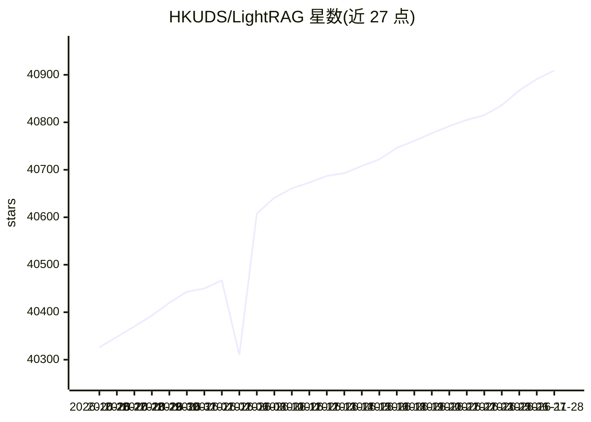

# HKUDS/LightRAG

⭐ 40,909 · Python · MIT · 推送 2026-11-27 · [GitHub](https://github.com/HKUDS/LightRAG) · [官网](https://arxiv.org/abs/2410.05779) · 组织维护 · 中文 README

**给开发者用的图结构 RAG 框架：文档入库→知识图谱检索问答**

来自 HKUDS 的检索增强生成框架：将文档解析、分块后抽取实体构建知识图谱，提供 naive/local/global/hybrid 等查询模式与重排序，输出带引用来源的回答；内置 API 服务器与 WebUI 支持文档插入、查询和图谱可视化。存储支持本地文件、PostgreSQL、Neo4j、MongoDB、OpenSearch 等；经 MinerU/Docling 集成多模态解析（RAG-Anything 已合并），并集成 RAGAS 评测与 Langfuse 追踪。部署方式包括 PyPI/uv、源码构建（WebUI 需 bun）与 Docker Compose，README 含共享网络部署的安全警告。

## 筛选速览

| 维度 | 判定 | 备注 |
|---|---|---|
| AI 角色 | `ai-ecosystem` | LLM/agent 周边工具 |
| 许可风险 | `permissive` | MIT |
| 部署形态 | `self-host` | docker 或自建部署 |
| 模型依赖 | local-ok | 支持本地模型 |
| 硬件要求 | — | 无带数字的原话,不猜 |
| 安装摩擦 | `low` | 无编译、无系统依赖或容器化 |
| 成熟度 | — | 结构信号不足 |

## 动量与使用信号

- 维护:`active` — 距上次 push 2.6 天,年发版 28,315 位贡献者
- 涨星:近 1 天 **+21**(自 20261016 起算)
- 安装:pypi 包 `cairosvg` 月下载 13,091,552
- 平台:— · 协议:OPENAI-API / OLLAMA

## 能力要点

- 基于知识图谱的索引与检索流程，支持 5 种文本分块策略（L14）
- 角色化 LLM 配置：EXTRACT/QUERY/KEYWORDS/VLM 四角色独立设置
- 存储后端可选本地文件、PostgreSQL、Neo4j、MongoDB、OpenSearch 等
- lightrag-server 提供 WebUI 与 Ollama 兼容 API，支持引用溯源

## 适用场景

- 把一批 PDF/Word 文档构建成可问答的知识库
- 需要引用出处与文档可追溯性的企业知识问答
- 用 Docker 在本地/内网自托管 RAG 服务
- 用 RAGAS 评测并追踪 RAG 检索质量

## 场景标签

`RAG` `知识图谱` `文档解析` `模型评测` · 领域:评测与运维

## 证据(README 行号)

> L3: # 🚀 LightRAG: Simple and Fast Retrieval-Augmented Generation
> L121: Open `http://localhost:9621/webui` for the WebUI. The interactive REST API docs are at `http://localhost:9621/docs
> L43: ## Installation

## 星数曲线

2026-10-26 40,326 → 2026-11-28 40,909（+583）

---
*卡片 v1 · prompt 1.4 · 生成 2026-11-24 · 置信度 high · 依据 README sha `7cb255d72f13` · [字段定义](../../DATASET.md)*
