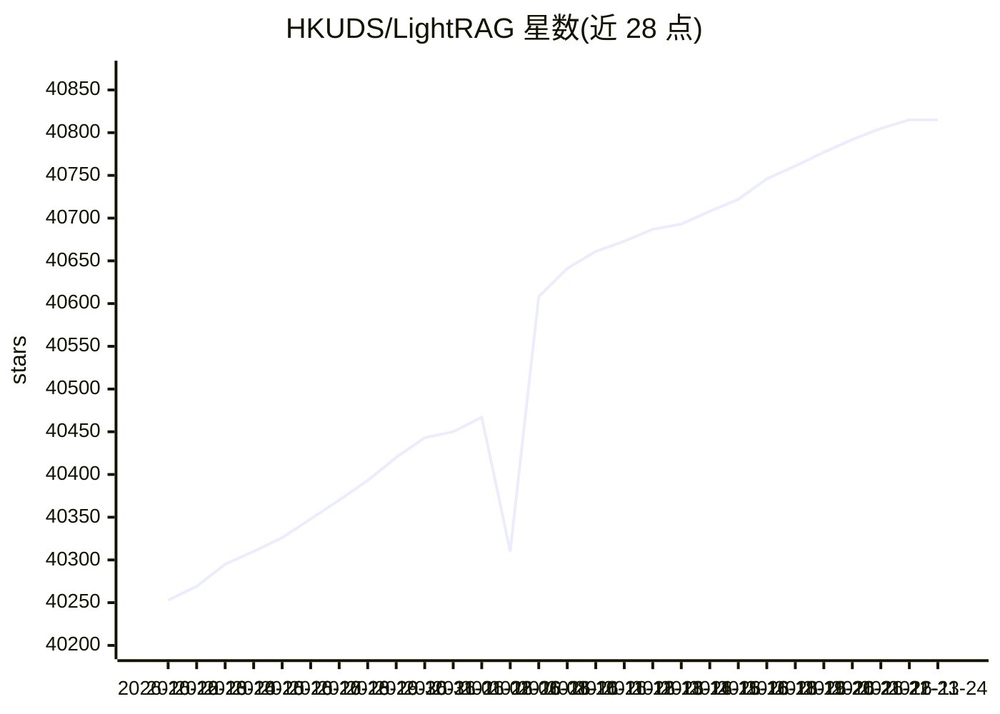

# HKUDS/LightRAG

⭐ 40,815 · Python · MIT · 推送 2026-11-22 · [GitHub](https://github.com/HKUDS/LightRAG) · [官网](https://arxiv.org/abs/2410.05779) · 组织维护 · 中文 README

**给开发者的图结构化检索增强生成框架与服务器**

LightRAG 提供基于知识图谱的检索增强生成（RAG）实现，包含 Python 库与带 WebUI 的 API 服务器（默认端口 9621）。机制上：文档经解析与分块后抽取实体构建知识图谱，查询支持多模式检索与 reranker；存储支持本地文件、PostgreSQL、Neo4j、MongoDB、OpenSearch 等后端；通过 RAG-Anything 集成 MinerU/Docling 做多模态解析，集成 RAGAS 评估与 Langfuse 追踪。限制：需配置 LLM 与嵌入模型的 API key 或兼容端点；服务器默认绑定 0.0.0.0 且认证默认关闭，README 提示共享网络部署前需绑定私有地址或启用认证。

## 筛选速览

| 维度 | 判定 | 备注 |
|---|---|---|
| AI 角色 | `ai-ecosystem` | LLM/agent 周边工具 |
| 许可风险 | `permissive` | MIT |
| 部署形态 | `self-host` | docker 或自建部署 |
| 模型依赖 | local-ok | 支持本地模型 |
| 硬件要求 | — | 无带数字的原话,不猜 |
| 安装摩擦 | `low` | 无编译、无系统依赖或容器化 |
| 成熟度 | — | 结构信号不足 |

## 动量与使用信号

- 维护:`active` — 距上次 push 2.6 天,年发版 28,315 位贡献者
- 涨星:近 1 天 **+21**(自 20261016 起算)
- 安装:pypi 包 `cairosvg` 月下载 13,091,552
- 平台:— · 协议:OPENAI-API / OLLAMA

## 能力要点

- 知识图谱索引与检索流程（indexing/retrieval flowchart 提供图示）
- 多存储后端：PostgreSQL/Neo4j/MongoDB/OpenSearch 可作一体化存储
- WebUI、REST API 与 Ollama 兼容路由（/api/*）
- 交互式 setup wizard 与 Docker Compose 部署

## 适用场景

- 把文档库建成知识图谱并提供 WebUI 查询
- 部署带来源引用（citation）的 RAG 问答服务
- 对 PDF/Office/表格/公式等多模态文档做解析与检索
- 离线/内网环境下预装依赖部署 RAG 服务

## 场景标签

`RAG` `知识图谱` `文档解析` · 领域:知识与检索

## 证据(README 行号)

> L3: # 🚀 LightRAG: Simple and Fast Retrieval-Augmented Generation
> L41: ## Installation
> L119: Open `http://localhost:9621/webui` for the WebUI. The interactive REST API docs are at `http://localhost:9621/docs

## 星数曲线

2026-10-22 40,253 → 2026-11-24 40,815（+562）

---
*卡片 v1 · prompt 1.4 · 生成 2026-11-23 · 置信度 high · 依据 README sha `bcd726939d40` · [字段定义](../../DATASET.md)*
