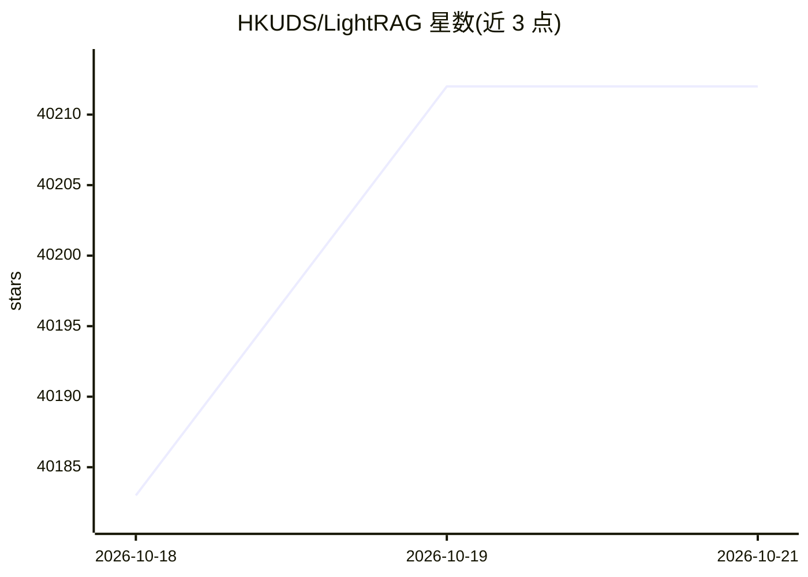

# HKUDS/LightRAG

⭐ 40,212 · Python · MIT · 推送 2026-10-15 · [GitHub](https://github.com/HKUDS/LightRAG) · [官网](https://arxiv.org/abs/2410.05779) · 组织维护

**面向开发者的轻量知识图谱 RAG 框架**

HKUDS 出品的轻量级知识图谱 RAG 框架，采用双层架构同时管理知识图谱与向量嵌入，支持增量更新与选择性删除、四种文本分块策略、多文档解析引擎（MinerU/Docling/Native）及多种存储后端（默认内存存储仅适合测试，生产推荐 PostgreSQL）。提供 PyPI/源码/Docker Compose 安装、WebUI、交互式配置向导，并可配合 30B 级开源 LLM 运行。已集成 RAGAS 评估与 Langfuse 追踪。

## 筛选速览

| 维度 | 判定 | 备注 |
|---|---|---|
| AI 角色 | `ai-native` | 本体是模型或模型工具 |
| 许可风险 | `permissive` | MIT |
| 部署形态 | `self-host` | docker 或自建部署 |
| 模型依赖 | — | README 未给出锁定关系 |
| 硬件要求 | — | 无带数字的原话,不猜 |
| 安装摩擦 | `low` | 无编译、无系统依赖或容器化 |
| 成熟度 | — | 结构信号不足 |

## 动量与使用信号

- 维护:`active` — 距上次 push 2.6 天,年发版 28,315 位贡献者
- 涨星:近 1 天 **+21**(自 20261016 起算)
- 安装:pypi 包 `cairosvg` 月下载 13,091,552
- 平台:— · 协议:OPENAI-API / OLLAMA

## 能力要点

- 双层架构：知识图谱 + 向量嵌入统一管理
- 四种分块策略与多文档解析引擎（MinerU/Docling/Native）
- 增量更新与文档删除时自动重建受影响实体关系
- 多种生产级存储后端与 WebUI、Docker 部署

## 适用场景

- 为垂直领域文档构建知识图谱问答系统
- 需要增量更新知识库的长期 RAG 应用
- 本地/私有化部署的多模态文档检索

## 场景标签

`RAG` `知识图谱` · 领域:知识与检索

## 证据(README 行号)

> L137: LightRAG is a lightweight knowledge-graph RAG framework and an efficient alternative to Microsoft GraphRAG. It ado
> L145: - **Multiple Document Parsing Engines:** LightRAG's document processing pipeline supports MinerU, Docling, and Nat

## 星数曲线

2026-10-18 40,183 → 2026-10-21 40,212（+29）

---
*卡片 v1 · prompt 1.4 · 生成 2026-10-18 · 置信度 high · 依据 README sha `4f795e60ea3e` · [字段定义](../../DATASET.md)*
