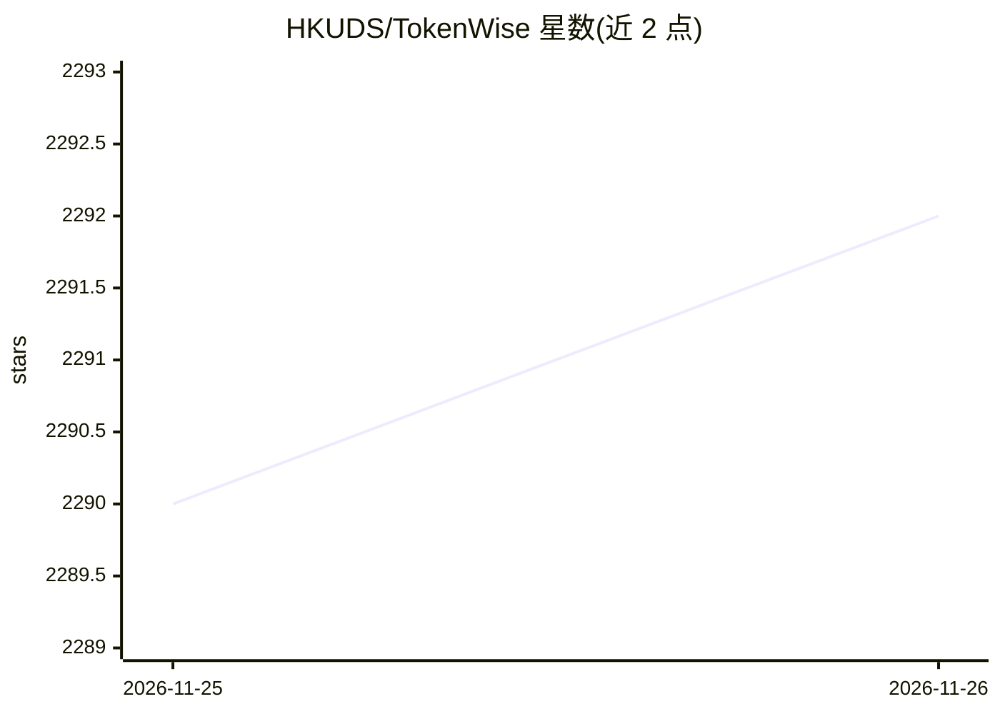

# HKUDS/TokenWise

⭐ 2,292 · TypeScript · MIT · 推送 2026-11-24 · [GitHub](https://github.com/HKUDS/TokenWise) · 组织维护 · 中文 README

**面向 9 种编码 Agent 的上下文压缩插件，减少 token 消耗**

以插件形式接入 Claude Code、Codex、GitHub Copilot CLI 等 9 个编码 Agent 及任意 shell：在内容送达模型前过滤冗余指令、日志与工具输出，保留任务关键上下文；从真实使用中学习压缩规则并在多个 Agent 与平台间共享。每次回答末尾展示节省的 token 数与百分比，提供 saved/dashboard/report/checkup/teach/learn/rules/recall 等命令。数据本地保存，原始输出 14 天后删除；学习轮次由用户自行启动并会经过所用 Agent 的模型提供方。支持 macOS 与 Linux，手动安装需 Node.js 22 与 pnpm。

## 筛选速览

| 维度 | 判定 | 备注 |
|---|---|---|
| AI 角色 | `ai-ecosystem` | LLM/agent 周边工具 |
| 许可风险 | `permissive` | MIT |
| 部署形态 | `library` | 以包/库形式分发 |
| 模型依赖 | — | README 未给出锁定关系 |
| 硬件要求 | — | 无带数字的原话,不猜 |
| 安装摩擦 | `low` | 无编译、无系统依赖或容器化 |
| 成熟度 | — | 结构信号不足 |

## 能力要点

- 提供 9 个 Agent 的适配器，含 in-process、hooks、MCP recall 等不同接入方式
- 从真实工作流学习压缩规则，可跨 Agent 共享策略
- 每次响应实时显示 token 节省量，附 dashboard 与 per-session 报告
- 原始内容仅存本地，14 天后删除，可用 TOKENWISE_DISABLE 关闭

## 适用场景

- 多模块大型代码库的长期软件工程任务中降低 token 开销
- 长文档深度问答场景压缩历史上下文
- 同时使用多个编码 Agent 时统一管理与统计 token 节省

## 场景标签

`编码 Agent` · 领域:编码与开发

## 证据(README 行号)

> L42: ## 🤖 Drop-In Plugin for the Agents You Already Use
> L134: |Claude Code 2.1+|hooks; the catalog follows Claude's own summary|`/tokenwise:learn`|
> L139: |Any agent or shell|`tokenwise run`, recall over MCP|`tokenwise learn`|

## 星数曲线

2026-11-25 2,290 → 2026-11-26 2,292（+2）

---
*卡片 v1 · prompt 1.4 · 生成 2026-11-24 · 置信度 high · 依据 README sha `67563b6a7e3b` · [字段定义](../../DATASET.md)*
