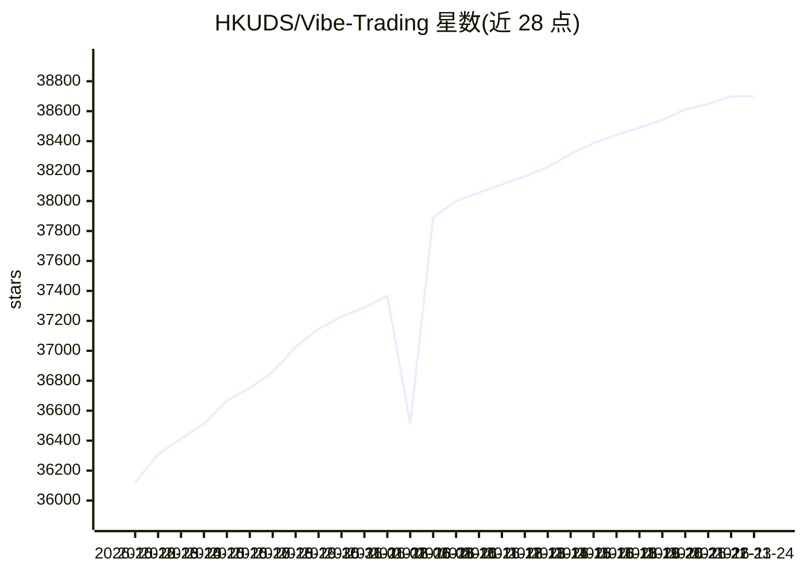

# HKUDS/Vibe-Trading

⭐ 38,699 · Python · MIT · 推送 2026-11-22 · [GitHub](https://github.com/HKUDS/Vibe-Trading) · [官网](https://vibetrading.wiki/) · 组织维护 · 中文 README

**个人量化交易 Agent：行情、回测与研究的一体化平台**

以 Python 包形式发布的交易 Agent 系统，覆盖历史行情获取、多市场回测（A股、美股、韩国/台湾/越南等市场规则）、期权分析（Options Lab）、研究实验（Research Lab，含训练/样本外/holdout 划分）与模拟盘交易，并提供 Web、CLI、API 与 Agent/MCP 多种入口。结果可溯源至数据源与运行记录，研究修订保留版本，实盘交易须用户授权限额。附带 Shadow Account、风险归因等模块，桌面版支持签名更新。

## 筛选速览

| 维度 | 判定 | 备注 |
|---|---|---|
| AI 角色 | `ai-native` | 本体是模型或模型工具 |
| 许可风险 | `permissive` | MIT |
| 部署形态 | `self-host` | docker 或自建部署 |
| 模型依赖 | — | README 未给出锁定关系 |
| 硬件要求 | — | 无带数字的原话,不猜 |
| 安装摩擦 | `low` | 无编译、无系统依赖或容器化 |
| 成熟度 | — | 结构信号不足 |

## 动量与使用信号

- 维护:`active` — 距上次 push 0.9 天,年发版 13,180 位贡献者
- 涨星:近 1 天 **+87**(自 20261016 起算)
- 安装:pypi 包 `vibe-trading-ai` 月下载 6,681
- 平台:— · 协议:MCP

## 能力要点

- 多市场回测引擎（A股/美股/台湾/韩国/越南/加密货币等规则）
- Web/CLI/API/Agent/MCP 四类入口共享工作流，11 种界面语言
- 统一行情数据网关与统一 LLM 网关，带来源与缓存元数据
- 研究成果修订版本化，可导出 JSON/Markdown 对比

## 适用场景

- 对多市场标的做历史回测与研究实验
- 通过 MCP 为自己的 Agent 增加交易工具能力
- 跑 A股 5 分钟模拟盘并独立对账费用与持仓
- 构建隐含波动率曲面并进行期权策略比较

## 场景标签

`金融量化` · 领域:学习与行业

## 证据(README 行号)

> L5:  Vibe-Trading: Your Personal Trading Agent
> L7:  One Command to Empower Your Agent with Comprehensive Trading Capabilities
> L43:  API / MCP &nbsp;&middot;&nbsp;

## 星数曲线

2026-10-22 36,121 → 2026-11-24 38,699（+2,578）

---
*卡片 v1 · prompt 1.4 · 生成 2026-11-23 · 置信度 low · 依据 README sha `14e72dc63ca6` · [字段定义](../../DATASET.md)*
