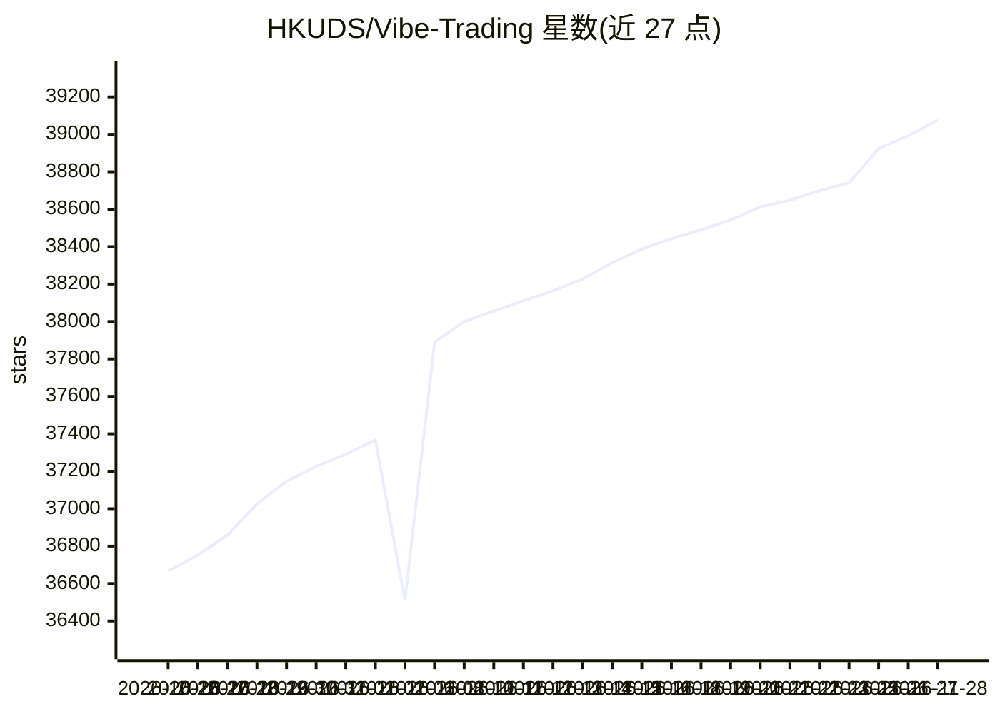

# HKUDS/Vibe-Trading

⭐ 39,077 · Python · MIT · 推送 2026-11-27 · [GitHub](https://github.com/HKUDS/Vibe-Trading) · [官网](https://vibetrading.wiki/) · 组织维护 · 中文 README

**给个人交易者的 Agent 平台：回测、研究与模拟交易**

Vibe-Trading 是一个以 Agent 为核心的量化交易工具：通过 pip 安装后提供回测（多市场引擎）、Research Lab 研究、Options Lab 期权分析、Alpha Zoo 因子基准、Shadow Account 模拟账户与 paper trading 等模块。支持 Web chat、CLI、API 与 MCP 入口，统一市场数据网关与 LLM 网关覆盖多数据源与多模型提供商。技术栈 Python/FastAPI/React，附技术报告（arXiv:2611.24845）。README 主体为更新日志，另有 Docs 与 Demo 入口。

## 筛选速览

| 维度 | 判定 | 备注 |
|---|---|---|
| AI 角色 | `ai-native` | 本体是模型或模型工具 |
| 许可风险 | `permissive` | MIT |
| 部署形态 | `self-host` | docker 或自建部署 |
| 模型依赖 | — | README 未给出锁定关系 |
| 硬件要求 | — | 无带数字的原话,不猜 |
| 安装摩擦 | `low` | 无编译、无系统依赖或容器化 |
| 成熟度 | — | 结构信号不足 |

## 动量与使用信号

- 维护:`active` — 距上次 push 0.9 天,年发版 13,180 位贡献者
- 涨星:近 1 天 **+87**(自 20261016 起算)
- 安装:pypi 包 `vibe-trading-ai` 月下载 6,681
- 平台:— · 协议:MCP

## 能力要点

- 统一市场数据网关与统一 LLM 网关（Agent/CLI/API/Swarm 共享）
- 回测、walk-forward 验证、Monte Carlo 与因子基准（Alpha Zoo）
- Shadow Account 模拟交易、paper trade 台账对账工具 paper_trade_reconcile
- 提供 Agent/MCP 工具与 Claude CLI provider 兼容层

## 适用场景

- 我回测美股、A 股、台股等市场的策略并做 walk-forward 验证
- 我通过 MCP 把交易能力接入自己的 Agent
- 我用模拟账户验证策略的成交、费用与净值核算

## 场景标签

`金融量化` `多智能体` · 领域:Agent 开发

## 证据(README 行号)

> L5:  Vibe-Trading: Your Personal Trading Agent
> L47:  pip install vibe-trading-ai
> L103: - **2026-11-11** 🧾 **Paper-trade partial fills and ledger reconciliation** — Opt into per-order volume caps, parti

## 星数曲线

2026-10-26 36,667 → 2026-11-28 39,077（+2,410）

---
*卡片 v1 · prompt 1.4 · 生成 2026-11-28 · 置信度 high · 依据 README sha `80b8ba79cd01` · [字段定义](../../DATASET.md)*
