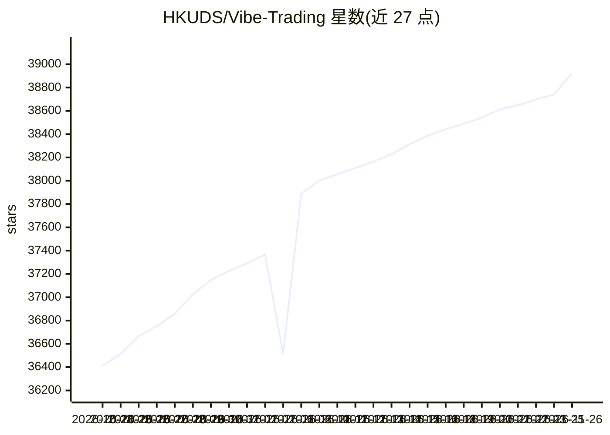

# HKUDS/Vibe-Trading

⭐ 38,924 · Python · MIT · 推送 2026-11-25 · [GitHub](https://github.com/HKUDS/Vibe-Trading) · [官网](https://vibetrading.wiki/) · 组织维护 · 中文 README

**个人量化交易 Agent：回测、研报、期权分析与实盘授权限制**

以 Python 包（pip install vibe-trading-ai）分发的个人交易 Agent，围绕 LLM 提供回测引擎（多市场日线/日内规则，含 A 股、台股、加密货币资金费率等）、Research Lab 研究回放与 walk-forward 验证导出、Options Lab 期权策略比较、Risk X-Ray 风险归因、Shadow Account 模拟账户，以及统一的市场数据网关与 LLM 网关；通过 Web、CLI、API/MCP 交付，技术报告描述其对结果溯源与实盘用户授权限制的机制。安装以 PyPI 为主，另有源码与 Docker 途径。

## 筛选速览

| 维度 | 判定 | 备注 |
|---|---|---|
| AI 角色 | `ai-native` | 本体是模型或模型工具 |
| 许可风险 | `permissive` | MIT |
| 部署形态 | `self-host` | docker 或自建部署 |
| 模型依赖 | — | README 未给出锁定关系 |
| 硬件要求 | — | 无带数字的原话,不猜 |
| 安装摩擦 | `low` | 无编译、无系统依赖或容器化 |
| 成熟度 | — | 结构信号不足 |

## 动量与使用信号

- 维护:`active` — 距上次 push 0.9 天,年发版 13,180 位贡献者
- 涨星:近 1 天 **+87**(自 20261016 起算)
- 安装:pypi 包 `vibe-trading-ai` 月下载 6,681
- 平台:— · 协议:MCP

## 能力要点

- 回测引擎覆盖多市场与价格限制、负价格、资金费率等规则校验
- Research Lab 支持 walk-forward 验证导出 CSV 与冻结回放
- 统一市场数据网关：多源回退、缓存、来源/币种/复权元数据
- Agent/MCP 工具：paper_trade_reconcile 台账对账、期权策略比较

## 适用场景

- 对股票、ETF、期权策略做回测与 walk-forward 验证
- 让交易 Agent 生成并留痕研究结论，导出修订对比
- 通过 MCP 接入市场数据与回测工具
- 用 Shadow Account 做模拟盘跟踪与费用对账

## 场景标签

`金融量化` · 领域:学习与行业

## 证据(README 行号)

> L7:  One Command to Empower Your Agent with Comprehensive Trading Capabilities
> L47:  pip install vibe-trading-ai
> L95: - **2026-11-11** 🧾 **Paper-trade partial fills and ledger reconciliation** — Opt into per-order volume caps, partia

## 星数曲线

2026-10-24 36,414 → 2026-11-26 38,924（+2,510）

---
*卡片 v1 · prompt 1.4 · 生成 2026-11-26 · 置信度 low · 依据 README sha `3b8fa6c301fd` · [字段定义](../../DATASET.md)*
