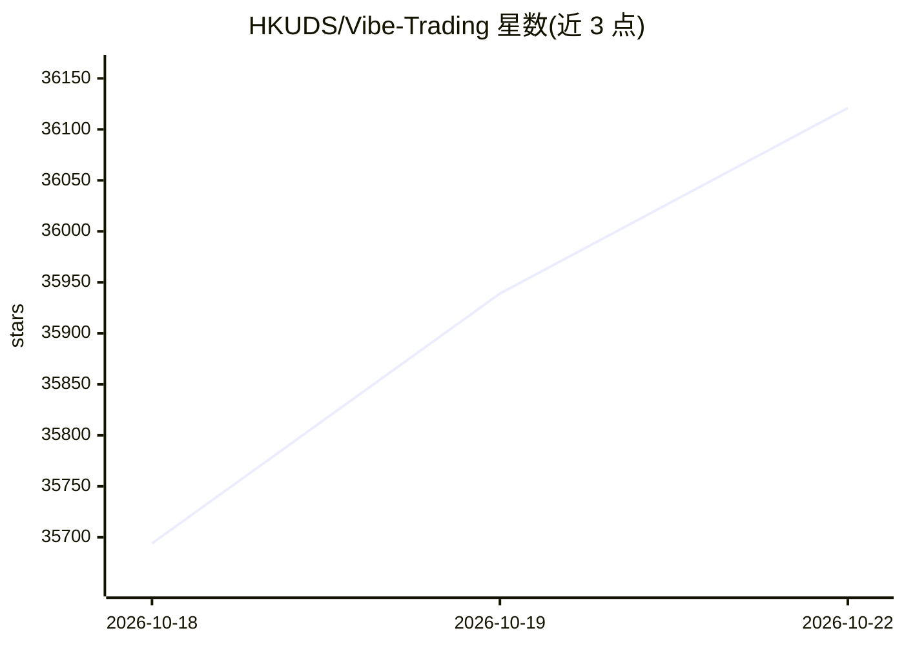

# HKUDS/Vibe-Trading

⭐ 36,121 · Python · MIT · 推送 2026-10-21 · [GitHub](https://github.com/HKUDS/Vibe-Trading) · [官网](https://vibetrading.wiki/) · 组织维护 · 中文 README

**个人交易 AI Agent：一句话驱动投研、回测与实盘交易**

HKUDS 出品的个人量化交易代理，以单条命令为用户提供综合交易能力：覆盖因子研究、回测（含 Monte Carlo、风险指标）、模拟与实盘 runner、多券商/数据源读取（Futu、KIS、Robinhood、Eastmoney、Stooq、Binance 等）、组合导入与定期报告（Email PDF 可选 AES-256 加密）。技术栈为 Python/FastAPI/React，支持 MCP 工具接入 agent，模型端点可自定义，具备凭证脱敏与 grounding 校验机制。以 pip 包安装。

## 筛选速览

| 维度 | 判定 | 备注 |
|---|---|---|
| AI 角色 | `ai-native` | 本体是模型或模型工具 |
| 许可风险 | `permissive` | MIT |
| 部署形态 | `library` | 以包/库形式分发 |
| 模型依赖 | — | README 未给出锁定关系 |
| 硬件要求 | — | 无带数字的原话,不猜 |
| 安装摩擦 | `medium` | 含编译或系统依赖之一 |
| 成熟度 | — | 结构信号不足 |

## 动量与使用信号

- 维护:`active` — 距上次 push 0.9 天,年发版 13,180 位贡献者
- 涨星:近 1 天 **+87**(自 20261016 起算)
- 安装:pypi 包 `vibe-trading-ai` 月下载 6,681
- 平台:— · 协议:MCP

## 能力要点

- 研究、回测与实盘 runner 一体的交易 agent
- 支持 MCP 与自定义模型端点接入
- 多市场/多券商数据读取与组合导入
- 定期报告支持 Email PDF（可选 AES-256 加密）

## 适用场景

- 用对话让 agent 完成投研、回测与下单
- 跨市场（A 股/港美股/加密）组合管理与定期报告
- 为自有 agent 通过 MCP 接入交易能力

## 场景标签

`金融量化` · 领域:学习与行业

## 证据(README 行号)

> L5:  Vibe-Trading: Your Personal Trading Agent
> L7:  One Command to Empower Your Agent with Comprehensive Trading Capabilities
> L29:  API / MCP &nbsp;&middot;&nbsp;

## 星数曲线

2026-10-18 35,694 → 2026-10-22 36,121（+427）

---
*卡片 v1 · prompt 1.4 · 生成 2026-10-20 · 置信度 mid · 依据 README sha `b639df1e44a8` · [字段定义](../../DATASET.md)*
