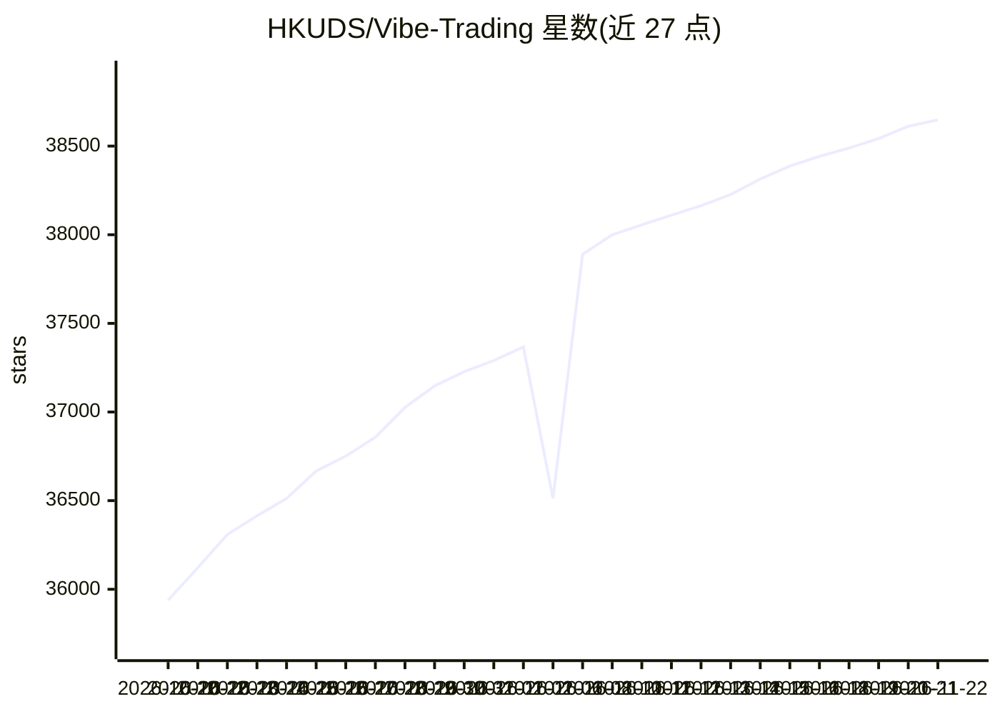

# HKUDS/Vibe-Trading

⭐ 38,648 · Python · MIT · 推送 2026-11-21 · [GitHub](https://github.com/HKUDS/Vibe-Trading) · [官网](https://vibetrading.wiki/) · 组织维护 · 中文 README

**给交易者的个人 AI 交易 Agent，覆盖研究、回测与模拟盘**

以 Python 包（pip install vibe-trading-ai）分发的个人交易 Agent，通过一条命令为 Agent 接入交易能力：包括 Web/CLI/API/Agent-MCP 多入口、Shadow Account 影子账户、Options Lab 期权分析、Research Lab 研究与样本外测试、多市场（A股、美股、台股、期货等）日线回测与五分钟 A 股模拟盘。结果可溯源至数据源与运行记录，实盘交易受用户授权限制约束。提供统一行情网关与统一 LLM 网关层。

## 筛选速览

| 维度 | 判定 | 备注 |
|---|---|---|
| AI 角色 | `ai-native` | 本体是模型或模型工具 |
| 许可风险 | `permissive` | MIT |
| 部署形态 | `self-host` | docker 或自建部署 |
| 模型依赖 | — | README 未给出锁定关系 |
| 硬件要求 | — | 无带数字的原话,不猜 |
| 安装摩擦 | `low` | 无编译、无系统依赖或容器化 |
| 成熟度 | — | 结构信号不足 |

## 动量与使用信号

- 维护:`active` — 距上次 push 0.9 天,年发版 13,180 位贡献者
- 涨星:近 1 天 **+87**(自 20261016 起算)
- 安装:pypi 包 `vibe-trading-ai` 月下载 6,681
- 平台:— · 协议:MCP

## 能力要点

- Agent/CLI/API/Web/MCP 多入口共享工作流，支持 11 种界面语言
- 多市场回测引擎（A 股、美股、韩/台/越市场）与 A 股 5 分钟模拟盘
- 研究工件版本化：保存证据、对比修订、复用早期回测
- 统一行情数据网关与统一 LLM 网关（共享目录与配置层）

## 适用场景

- 在实盘前用模拟盘和影子账户检验交易策略
- 让 Agent 帮我做股票研究、回测与期权策略比较
- 把可版本化的研究结论保存下来跨会话复用

## 场景标签

`金融量化` · 领域:学习与行业

## 证据(README 行号)

> L5:  Vibe-Trading: Your Personal Trading Agent
> L7:  One Command to Empower Your Agent with Comprehensive Trading Capabilities
> L45:  pip install vibe-trading-ai

## 星数曲线

2026-10-20 35,939 → 2026-11-22 38,648（+2,709）

---
*卡片 v1 · prompt 1.4 · 生成 2026-11-22 · 置信度 mid · 依据 README sha `f4d85791c170` · [字段定义](../../DATASET.md)*
