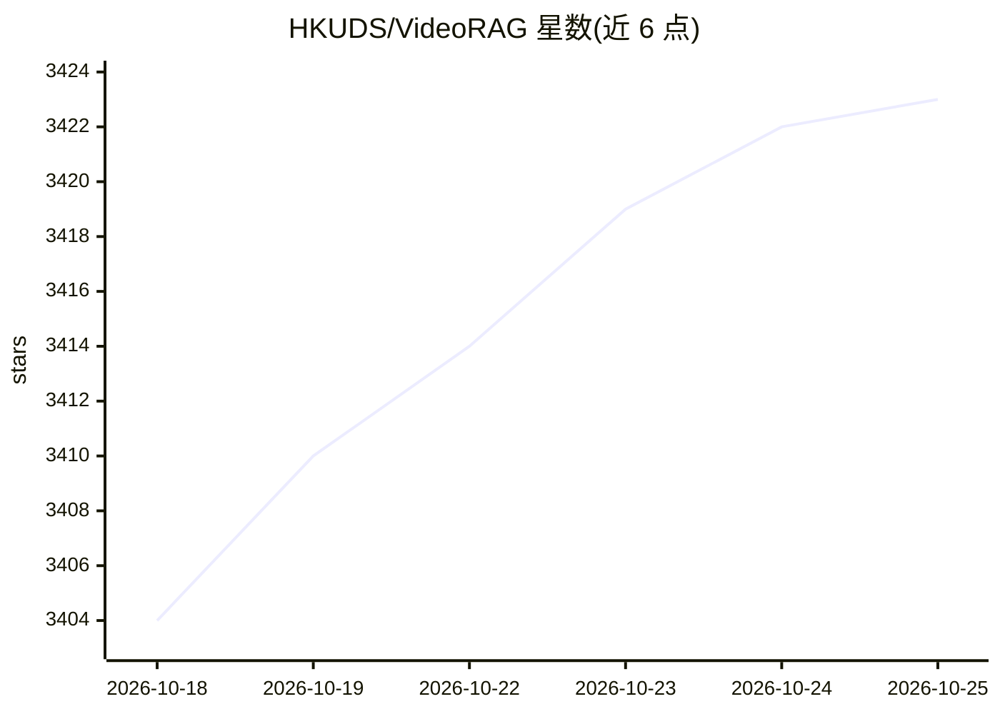

# HKUDS/VideoRAG

⭐ 3,424 · Python · NOASSERTION · 推送 2026-03-18 · [GitHub](https://github.com/HKUDS/VideoRAG) · [官网](https://arxiv.org/abs/2502.01549) · 组织维护

**面向用户的视频对话桌面应用：基于 VideoRAG 与超长视频问答**

HKUDS 团队推出的桌面应用 Vimo，让用户以自然语言与视频对话：拖拽上传 MP4/MKV/AVI 等格式，支持从短视频到数百小时超长视频的问答、跨视频分析与时刻检索。底层为 VideoRAG 框架的双通道架构（多模态知识图谱索引、分层上下文编码、自适应检索），单张 RTX 3090（24GB）可处理数百小时内容。桌面安装包尚未发布（macOS Apple Silicon Beta 标注 Coming Soon），当前需自行搭建 Python 后端并启动 Electron 前端。另开源 LongerVideos 基准（164 视频、约 134.6 小时）。

## 筛选速览

| 维度 | 判定 | 备注 |
|---|---|---|
| AI 角色 | `ai-native` | 本体是模型或模型工具 |
| 许可风险 | `none` | NOASSERTION |
| 部署形态 | `None` |  |
| 模型依赖 | — | README 未给出锁定关系 |
| 硬件要求 | — | 无带数字的原话,不猜 |
| 安装摩擦 | `low` | 无编译、无系统依赖或容器化 |
| 成熟度 | `idea` | |

## 能力要点

- 支持数百小时级超长视频的问答与跨视频分析
- VideoRAG 双通道架构：图驱动知识索引 + 分层上下文编码
- LongerVideos 基准：164 个视频、602 个查询、约 134.6 小时
- 跨平台（macOS/Windows/Linux），支持 MP4/MKV/AVI 等格式

## 适用场景

- 上传讲座或纪录片并就内容提问
- 在多个视频中定位特定画面或场景时刻
- 研究人员复现长视频理解算法与评测基准

## 场景标签

`多模态` · 领域:感知与多模态

## 证据(README 行号)

> L12: Vimo is a revolutionary desktop application that lets you **chat with your videos** using cutting-edge AI technolog
> L79: 1. Set up the Python backend environment and start the VideoRAG server
> L80: 2. Launch the Electron frontend application

## 星数曲线

2026-10-18 3,404 → 2026-10-25 3,423（+19）

---
*卡片 v1 · prompt 1.4 · 生成 2026-10-20 · 置信度 high · 依据 README sha `b23005e6b343` · [字段定义](../../DATASET.md)*
