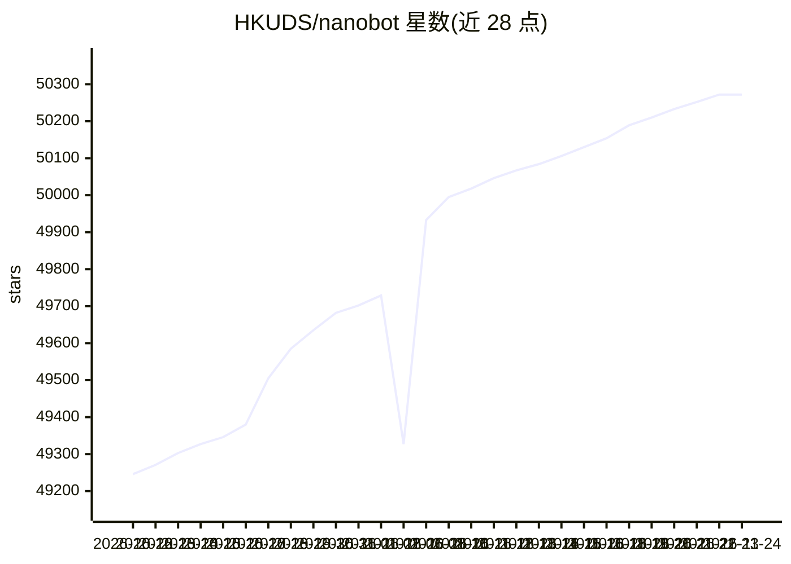

# HKUDS/nanobot

⭐ 50,272 · Python · MIT · 推送 2026-11-22 · [GitHub](https://github.com/HKUDS/nanobot) · [官网](https://nanobot.wiki) · 组织维护 · 中文 README

**自托管个人 AI agent：在浏览器/终端/聊天应用中对话干活**

用 Python 编写的轻量自托管个人 AI agent，用户可从浏览器 WebUI、终端 TUI 或 15+ 聊天应用（Telegram、Discord、Slack、飞书、微信、WhatsApp、Email 等）与其对话，完成文件读写、图片/PDF/Office 文件读取、工具调用、长期记忆（Dream）与定时任务、本地触发器和持续目标。模型可接入云端 API、OAuth 订阅或本地服务器（Ollama、vLLM、LM Studio），支持 MCP 服务器与插件，提供 Python SDK 嵌入，可部署在个人笔记本或 VPS。

## 筛选速览

| 维度 | 判定 | 备注 |
|---|---|---|
| AI 角色 | `ai-native` | 本体是模型或模型工具 |
| 许可风险 | `permissive` | MIT |
| 部署形态 | `self-host` | docker 或自建部署 |
| 模型依赖 | local-ok | 支持本地模型 |
| 硬件要求 | — | 无带数字的原话,不猜 |
| 安装摩擦 | `low` | 无编译、无系统依赖或容器化 |
| 成熟度 | — | 结构信号不足 |

## 动量与使用信号

- 维护:`active` — 距上次 push 0.6 天,年发版 20,389 位贡献者
- 涨星:近 1 天 **+47**(自 20261016 起算)
- 安装:pypi 包 `nanobot-ai` 月下载 47,015
- 平台:WEB · 协议:OPENAI-API / MCP / OLLAMA

## 能力要点

- 单一 Python 网关同时驱动 WebUI、TUI 与 15+ 聊天应用
- 读取图片、PDF 与 Office 文件，支持 MCP 服务器、插件与技能市场
- 长期记忆（Dream）、定时任务、本地触发器与持续目标自动化
- 支持云端 API、OAuth 订阅与本地模型服务器三种接入方式

## 适用场景

- 在微信/Telegram/Slack 等聊天工具里与个人助理对话处理文件任务
- 在自己笔记本或 VPS 上自托管一个带记忆与定时任务的 AI 助手
- 用本地模型服务器（Ollama/vLLM/LM Studio）运行私人 agent
- 通过 WebUI 多窗格管理多个话题并检查工具调用与文件 diff

## 场景标签

`AI 助手` `聊天机器人` · 领域:对话与助手

## 证据(README 行号)

> L29: 🐈 **nanobot** is a lightweight, open-source, self-hosted personal AI agent written in Python. Chat with it from you
> L35: - **Works where you already chat:** Connect seamlessly to 15+ chat apps including Telegram, Discord, Slack, Feishu,
> L36: - **Real tools, memory & automations:** Reads images, PDFs, and Office files (`.docx`, `.xlsx`, `.pptx`), edits fil

## 星数曲线

2026-10-22 49,246 → 2026-11-24 50,272（+1,026）

---
*卡片 v1 · prompt 1.4 · 生成 2026-11-22 · 置信度 mid · 依据 README sha `4a0a7c2b353f` · [字段定义](../../DATASET.md)*
