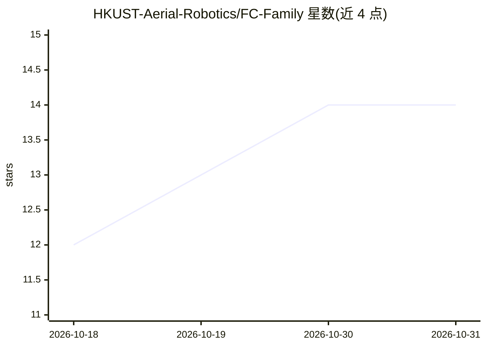

# HKUST-Aerial-Robotics/FC-Family

⭐ 14 · 推送 2026-08-29 · [GitHub](https://github.com/HKUST-Aerial-Robotics/FC-Family) · 组织维护

**无人机主动感知与空中操作系列研究项目合集**

HKUST-Aerial-Robotics 维护的空中机器人研究项目集合，目标是让无人机在开放世界环境中执行超越移动能力的任务，如主动感知与灵巧操作。项目列表包含多篇发表论文对应的系统：PredRecon（预测增强的空中重建规划器）、FC-Planner（空中覆盖全局规划器）、SOAR（异构多机重建规划器）、FC-Vision（在线遮挡感知重规划）、FlyCo（开放世界主动感知系统）、FC-CLAMP（空中操作全身协调学习）。面向科研用户，README 仅含项目索引，无安装运行说明。

## 筛选速览

| 维度 | 判定 | 备注 |
|---|---|---|
| AI 角色 | `ai-knowledge` | 知识聚合/清单类 |
| 许可风险 | `none` | — |
| 部署形态 | `None` |  |
| 模型依赖 | — | README 未给出锁定关系 |
| 硬件要求 | — | 无带数字的原话,不猜 |
| 安装摩擦 | `low` | 无编译、无系统依赖或容器化 |
| 成熟度 | — | 结构信号不足 |

## 能力要点

- 收录 6 个以上空中机器人研究子项目
- 覆盖空中重建、覆盖规划、多机协同、空中操作方向
- 多个子项目对应 ICRA/IROS/RA-L 论文

## 适用场景

- 查找空中主动感知与操作方向的论文及对应系统
- 了解 HKUST 空中机器人研究组的成果布局

## 场景标签

`科研工具` · 领域:学习与行业

## 证据(README 行号)

> L13: We aim to develop aerial robots that can operate robustly and intelligently in open-world environments, with a part
> L21: * PredRecon (ICRA 2023): Prediction-boosted Planner for Aerial Reconstruction.

## 星数曲线

2026-10-18 12 → 2026-10-31 14（+2）

---
*卡片 v1 · prompt 1.4 · 生成 2026-10-31 · 置信度 high · 依据 README sha `3f4cf916380f` · [字段定义](../../DATASET.md)*
