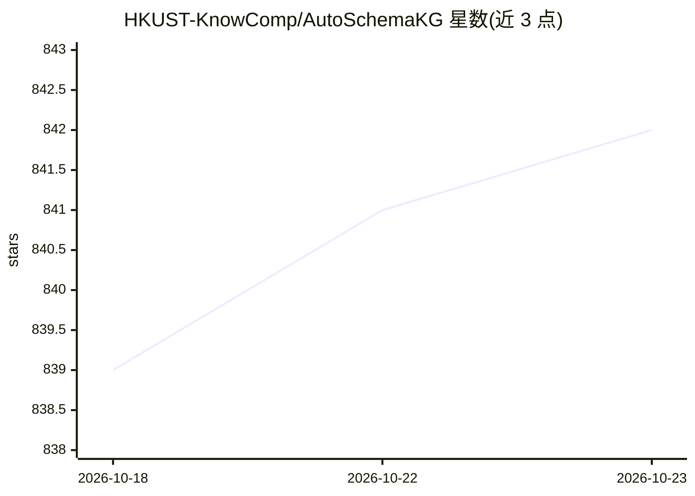

# HKUST-KnowComp/AutoSchemaKG

⭐ 842 · Python · MIT · 推送 2026-04-29 · [GitHub](https://github.com/HKUST-KnowComp/AutoSchemaKG) · [官网](https://hkust-knowcomp.github.io/AutoSchemaKG/) · 组织维护

**面向开发者的自动知识图谱构建框架：LLM 抽取三元组并归纳 schema**

HKUST KnowComp 团队的知识图谱构建框架，采用两阶段方法：用 LLM 从非结构化文本抽取实体与事件三元组，再通过概念化自动归纳图谱 schema，支持无预定义 schema 的自主构建。附带 ATLAS 系列知识图谱（900+ 百万节点、5.9 亿/59 亿边，来自 Wikipedia/学术论文/Common Crawl，Hugging Face 提供数据与 Neo4j CSV），并以 atlas-rag Python 包提供图谱托管、RAG 与多跳问答评测；支持多语言、PDF/Markdown 转换与并行生成。

## 筛选速览

| 维度 | 判定 | 备注 |
|---|---|---|
| AI 角色 | `ai-ecosystem` | LLM/agent 周边工具 |
| 许可风险 | `permissive` | MIT |
| 部署形态 | `library` | 以包/库形式分发 |
| 模型依赖 | — | README 未给出锁定关系 |
| 硬件要求 | — | 无带数字的原话,不猜 |
| 安装摩擦 | `low` | 无编译、无系统依赖或容器化 |
| 成熟度 | — | 结构信号不足 |

## 能力要点

- 两阶段流程：LLM 三元组抽取 + 概念化 schema 归纳
- ATLAS 家族图谱（900+ 百万节点、5.9 billion 边）及 Neo4j CSV 数据发布
- atlas-rag 包支持十亿级图谱托管与 RAG、多跳问答评测
- 支持中/日/韩等多语言、PDF/Markdown 转换与并行生成

## 适用场景

- 从自有文档（PDF/Markdown/多语言文本）构建知识图谱
- 在 ATLAS 大规模图谱之上搭建 RAG 与多跳问答
- 在 MuSiQue/HotpotQA/2WikiMultiHopQA 上复现评测结果

## 场景标签

`知识图谱` `RAG` · 领域:知识与检索

## 证据(README 行号)

> L21: 1. **Knowledge Graph Triple Extraction**: Extract triples comprising entities and events from text by using LLMs
> L22: 2. **Schema Induction**: Automatically generate schema for the knowledge graph by using conceptualization and creat

## 星数曲线

2026-10-18 839 → 2026-10-23 842（+3）

---
*卡片 v1 · prompt 1.4 · 生成 2026-10-21 · 置信度 high · 依据 README sha `8bc404c31c1c` · [字段定义](../../DATASET.md)*
