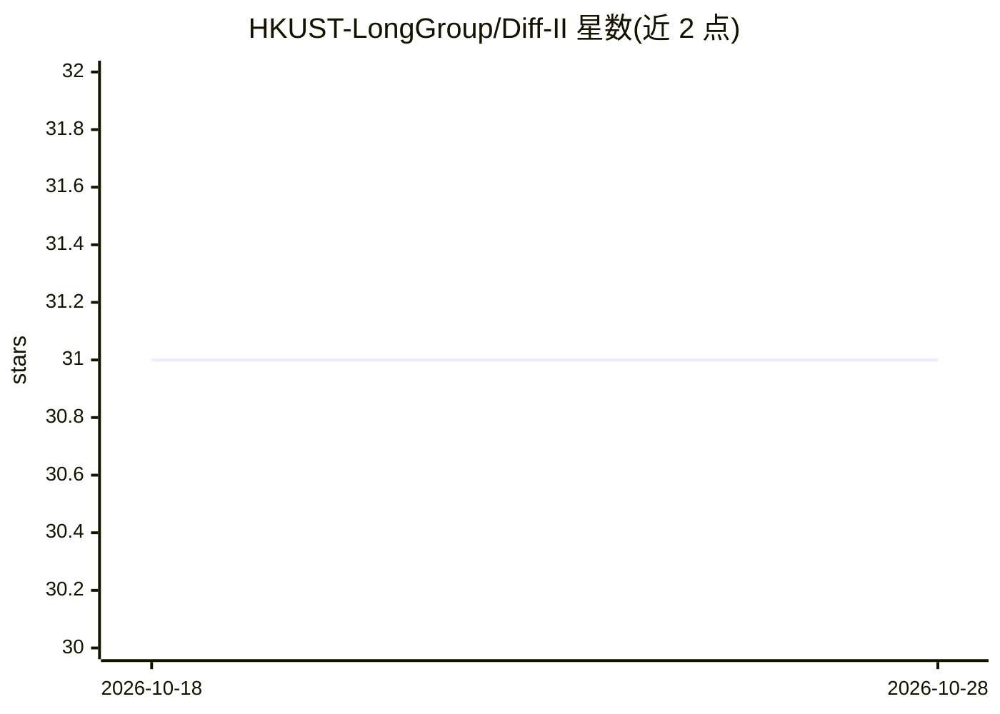

# HKUST-LongGroup/Diff-II

⭐ 31 · Python · 推送 2026-08-22 · [GitHub](https://github.com/HKUST-LongGroup/Diff-II) · [官网](https://arxiv.org/pdf/2408.16266) · 组织维护

**CVPR 2025 扩散模型图像增广方法的 PyTorch 实现**

Diff-II（Inversion Circle Interpolation）的官方 PyTorch 实现，为 CVPR 2025 接收的生成式数据增广方法，用于数据稀缺场景下的分类任务图像增广。使用流程：conda 创建环境、脚本下载数据集与已学概念及后缀、修改 run.sh 后运行；作者在 8 x 3090Ti GPU 上实现，可通过修改超参数调整 GPU 数量。面向复现或扩展该方法的研究人员。

## 筛选速览

| 维度 | 判定 | 备注 |
|---|---|---|
| AI 角色 | `ai-native` | 本体是模型或模型工具 |
| 许可风险 | `none` | — |
| 部署形态 | `None` |  |
| 模型依赖 | — | README 未给出锁定关系 |
| 硬件要求 | — | 无带数字的原话,不猜 |
| 安装摩擦 | `low` | 无编译、无系统依赖或容器化 |
| 成熟度 | — | 结构信号不足 |

## 能力要点

- CVPR 2025 论文 Diff-II 的官方 PyTorch 实现
- 基于扩散模型的图像增广，面向数据稀缺分类任务
- 提供数据集、已学概念与后缀的下载脚本
- 作者在 8 x 3090Ti GPU 上实现，可调 GPU 数量

## 适用场景

- 复现论文的生成式数据增广实验
- 在数据稀缺的分类任务上扩充训练数据
- 基于代码开展扩散增广方法的后续研究

## 场景标签

`图像生成` · 领域:内容生成

## 证据(README 行号)

> L1: # Inversion Circle Interpolation: Diffusion-based Image Augmentation for Data-scarce Classification (CVPR 2025)
> L3: **Diff-II is a novel and effective generative data augmentation method.**

## 星数曲线

2026-10-18 31 → 2026-10-28 31（+0）

---
*卡片 v1 · prompt 1.4 · 生成 2026-10-26 · 置信度 high · 依据 README sha `1651d3844c89` · [字段定义](../../DATASET.md)*
