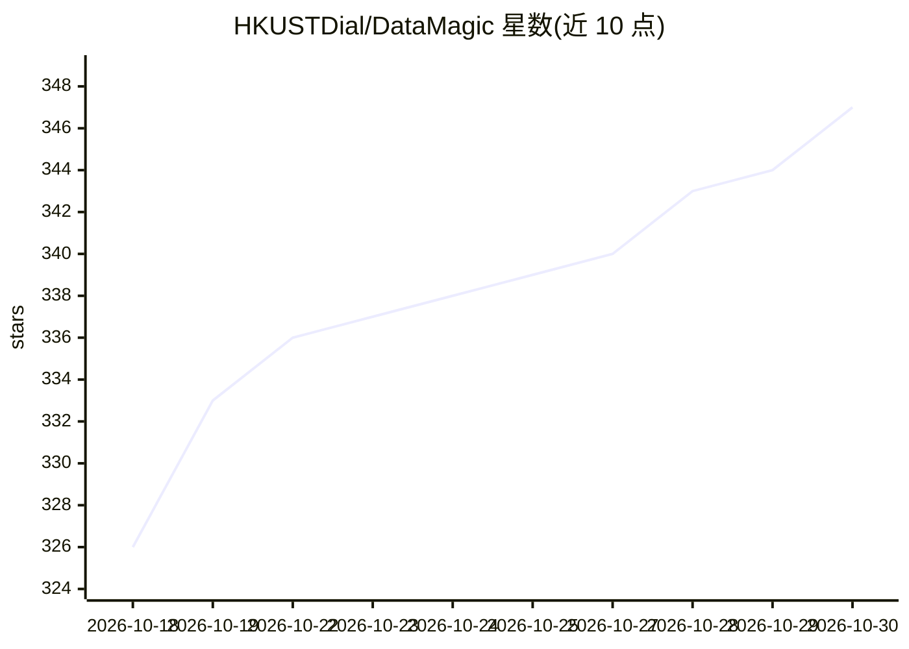

# HKUSTDial/DataMagic

⭐ 347 · TypeScript · MIT · 推送 2026-10-23 · [GitHub](https://github.com/HKUSTDial/DataMagic) · [官网](https://datamagic.chat/) · 组织维护 · 中文 README

**139 张动态数据视频配方卡库，供编程智能体复用生成数据视频**

面向创作者、分析师与研究者的数据可视化配方库：收录 139 张动态配方卡（动画预览、可编辑源码、示例数据）与 8 套故事蓝图，覆盖角色主持、柱状图竞赛、地图比较、9:16 竖屏等效果。使用流程为 git clone 仓库后，将实现指令与数据交给编程智能体，配套 datamagic Skill 指导其读取配方、改模板、渲染视频并检查结果。另有在线系统提供从表格上传到旁白视频导出的完整流程。配方默认中文，另提供英文版。

## 筛选速览

| 维度 | 判定 | 备注 |
|---|---|---|
| AI 角色 | `ai-knowledge` | 知识聚合/清单类 |
| 许可风险 | `permissive` | MIT |
| 部署形态 | `None` |  |
| 模型依赖 | — | README 未给出锁定关系 |
| 硬件要求 | — | 无带数字的原话,不猜 |
| 安装摩擦 | `low` | 无编译、无系统依赖或容器化 |
| 成熟度 | — | 结构信号不足 |

## 能力要点

- 139 张可预览、可编辑的数据图表与故事配方卡
- datamagic Skill 指导编程智能体读取配方、改模板、渲染视频
- 8 套故事蓝图支持多镜头叙事组合
- 支持 9:16 竖屏版式与中文/英文关键词搜索

## 适用场景

- 我想用自己的表格数据做成带旁白的动态数据视频
- 让编程智能体按我的数据推荐并套用合适的图表配方
- 把多个镜头组合成 30 秒的数据故事短视频

## 场景标签

`视频生成` · 领域:内容生成

## 证据(README 行号)

> L14: DataMagic 提供 **139 张动态配方卡**，每张都有动画预览、可编辑源码和示例数据。选中一个效果，将实现指令和自己的数据交给编程智能体；配套的 `datamagic` Skill 会指导它读取配方、修改模板、渲染视频并
> L18: - **[2026.10.02]** 🎉 发布 **DataMagic 动态配方库**：139 张可预览、可编辑的数据图表与故事配方，配套 **datamagic Skill**，让编程智能体用你的数据制作视频。

## 星数曲线

2026-10-18 326 → 2026-10-30 347（+21）

---
*卡片 v1 · prompt 1.4 · 生成 2026-10-21 · 置信度 high · 依据 README sha `e005667d77d6` · [字段定义](../../DATASET.md)*
