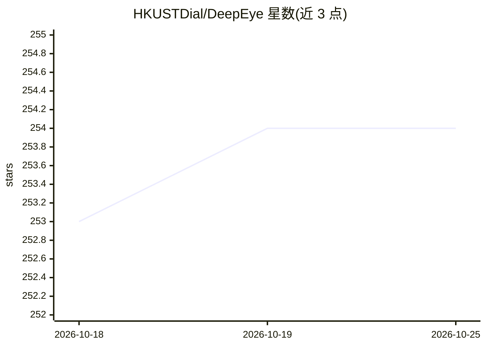

# HKUSTDial/DeepEye

⭐ 254 · Python · Apache-2.0 · 推送 2026-08-09 · [GitHub](https://github.com/HKUSTDial/DeepEye) · [官网](http://deepeye.hk) · 组织维护

**自驱动数据 Agent 系统：从异构数据自动生成视频、看板与报告**

面向数据分析场景的工作流式 LLM Agent 系统：用户在对话中描述分析目标，系统将意图分解为 AgentNode 与 ToolNode 组成的 DAG，经编译、校验、优化后由沙箱化节点执行，产出数据视频、交互式看板和分析报告三类产物。支持 PostgreSQL/MySQL/CSV/Excel/JSON/PDF 等异构数据源接入，提供节点级 SQL 与输入输出检查、人在环路的运行控制。以 Docker Compose 全栈交付（Postgres/Redis/MinIO/Celery 等），README 提示默认栈应视为本地开发环境，公开部署前需自行加固。

## 筛选速览

| 维度 | 判定 | 备注 |
|---|---|---|
| AI 角色 | `ai-native` | 本体是模型或模型工具 |
| 许可风险 | `permissive` | Apache-2.0 |
| 部署形态 | `self-host` | docker 或自建部署 |
| 模型依赖 | — | README 未给出锁定关系 |
| 硬件要求 | — | 无带数字的原话,不猜 |
| 安装摩擦 | `low` | 无编译、无系统依赖或容器化 |
| 成熟度 | — | 结构信号不足 |

## 能力要点

- 自然语言生成工作流 DAG，产出数据视频/看板/报告三类分析产物
- 统一接入数据库、CSV/Excel、JSON/XML、PDF/Markdown 等异构数据源
- 编译-校验-优化-执行四阶段工作流引擎，节点级沙箱执行与 SQL 检查
- Docker Compose 一键启动全栈（Postgres/Redis/MinIO/后端/前端/nginx）

## 适用场景

- 对销售/财务等业务数据做端到端自动分析并生成报告
- 把多个异构数据源接入同一工作流做迭代分析
- 在节点级别审查每一步执行的 SQL 与输出再确认运行

## 场景标签

`数据分析` · 领域:效率与自动化

## 证据(README 行号)

> L9: **DeepEye** is a production-ready, steerable self-driving data agent system. Unlike linear "ChatBI" tools, DeepEye a
> L32: Given heterogeneous data sources, DeepEye autonomously orchestrates a workflow and delivers Data Videos 🎬, Dashboar
> L96: ```

## 星数曲线



2026-10-18 253 → 2026-10-25 254（+1）


---
*卡片 v1 · prompt 1.4 · 生成 2026-10-22 · 置信度 high · 依据 README sha `2a721efda1d0` · [字段定义](../../DATASET.md)*
