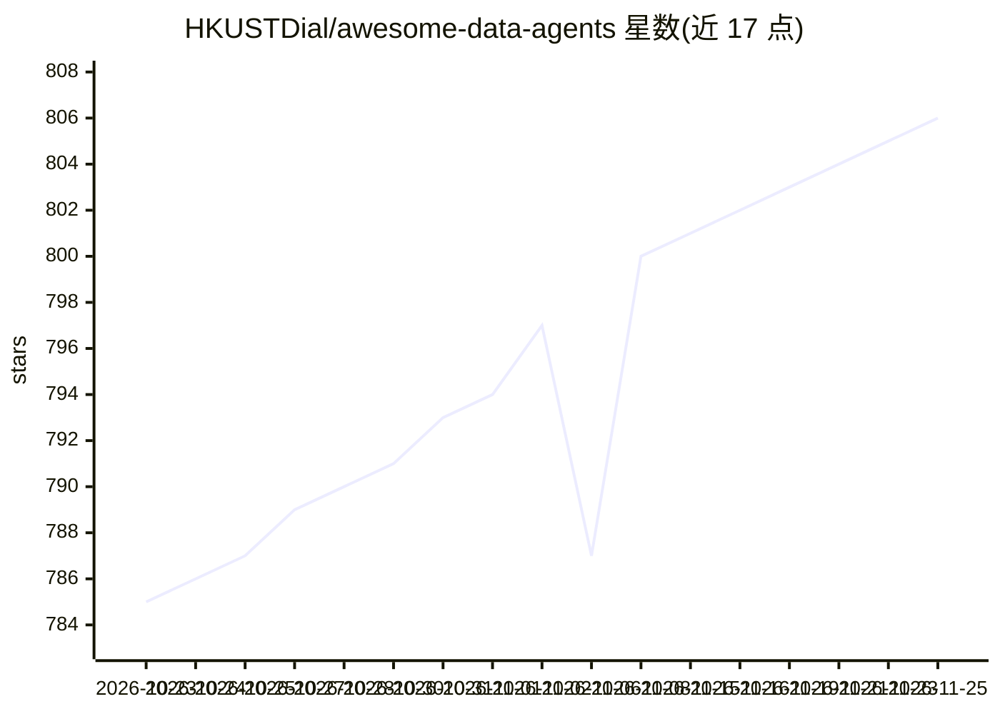

# HKUSTDial/awesome-data-agents

⭐ 806 · Python · 推送 2026-11-08 · [GitHub](https://github.com/HKUSTDial/awesome-data-agents) · [官网](https://arxiv.org/abs/2510.23587) · 组织维护

**数据智能体论文清单：配套综述的分类论文集**

配套 arXiv 综述《A Survey of Data Agents: Emerging Paradigm or Overstated Hype?》持续更新的论文清单。借鉴 SAE J3016 自动驾驶分级提出数据智能体 L0-L5 六级自治分类，论文按自治级别组织，再按数据管理、数据准备、数据分析三类任务细分（配置调优、查询优化、数据清洗、NL2SQL、NL2VIS 等），并附 L1 级对比表、相关综述与教程资源。曾在 SIGMOD 2026 举办三小时教程，并关联 KDD Cup 2026 数据智能体赛道。

## 筛选速览

| 维度 | 判定 | 备注 |
|---|---|---|
| AI 角色 | `ai-knowledge` | 知识聚合/清单类 |
| 许可风险 | `none` | — |
| 部署形态 | `None` |  |
| 模型依赖 | — | README 未给出锁定关系 |
| 硬件要求 | — | 无带数字的原话,不猜 |
| 安装摩擦 | `low` | 无编译、无系统依赖或容器化 |
| 成熟度 | — | 结构信号不足 |

## 能力要点

- L0-L5 六级自治度分类框架（对标 SAE J3016）
- 论文按自治级别×任务类别双重组织
- 包含 L1 级数据智能体能力对比表
- 配套 SIGMOD 2026 教程幻灯片与 KDD Cup 2026 赛道

## 适用场景

- 查找数据智能体某个子方向（如 NL2SQL、配置调优）的代表论文
- 了解数据智能体领域的研究分级与现状
- 撰写综述或开题时检索相关文献

## 场景标签

`精选清单` · 领域:学习与行业

## 证据(README 行号)

> L12: > Curated papers and resources on **Data Agents**. Companion repo and paper list for our survey on data agents - *A
> L67: We index papers **by autonomy level**, then **by data-related tasks** across Data Management, Data Preparation, and

## 星数曲线

2026-10-23 785 → 2026-11-25 806（+21）

---
*卡片 v1 · prompt 1.4 · 生成 2026-11-24 · 置信度 high · 依据 README sha `1aad7fe16ad8` · [字段定义](../../DATASET.md)*
