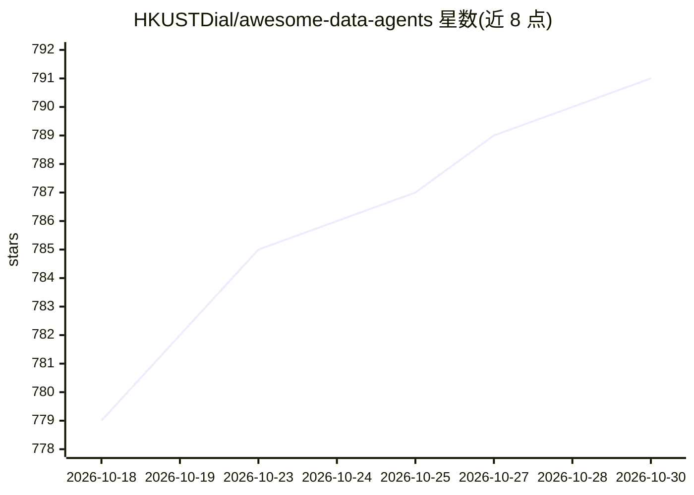

# HKUSTDial/awesome-data-agents

⭐ 791 · Python · 推送 2026-08-05 · [GitHub](https://github.com/HKUSTDial/awesome-data-agents) · [官网](https://arxiv.org/abs/2510.23587) · 组织维护

**数据智能体（Data Agents）综述配套论文清单，按自主性分级编目**

HKUSTDial 团队论文《A Survey of Data Agents: Emerging Paradigm or Overstated Hype?》的配套仓库：持续更新的 Data Agents 论文与资源清单。参照 SAE J3016 提出六级自主性分类（L0 手工至 L5 完全自主），论文按自主性级别与数据管理（配置调优、查询优化、系统诊断）、数据准备（清洗、集成、发现）、数据分析（TableQA、NL2SQL、NL2VIS、非结构化分析、报告生成）等任务组织，并附 SIGMOD 2026 教程幻灯片与 KDD Cup 2026 信息。仅提供论文条目，不含可安装代码。

## 筛选速览

| 维度 | 判定 | 备注 |
|---|---|---|
| AI 角色 | `ai-knowledge` | 知识聚合/清单类 |
| 许可风险 | `none` | — |
| 部署形态 | `None` |  |
| 模型依赖 | — | README 未给出锁定关系 |
| 硬件要求 | — | 无带数字的原话,不猜 |
| 安装摩擦 | `low` | 无编译、无系统依赖或容器化 |
| 成熟度 | — | 结构信号不足 |

## 能力要点

- 六级自主性分类框架（L0–L5）组织数据智能体研究
- 按数据管理/准备/分析三大任务域细分论文条目
- 附 SIGMOD 2026 三小时教程幻灯片与综述论文
- 跟踪 L2→L3 过渡等演进趋势与调查类文献

## 适用场景

- 查找数据智能体方向的论文与调研入口
- 按自主性级别定位数据库调优、数据清洗、NL2SQL 等子领域研究
- 跟踪 Data Agents 领域教程与竞赛动态

## 场景标签

`精选清单` `科研工具` · 领域:学习与行业

## 证据(README 行号)

> L12: > Curated papers and resources on **Data Agents**. Companion repo and paper list for our survey on data agents - *A
> L39: The rapid advancement of large language models (LLMs) has spurred the emergence of data agents — autonomous systems

## 星数曲线

2026-10-18 779 → 2026-10-30 791（+12）

---
*卡片 v1 · prompt 1.4 · 生成 2026-10-22 · 置信度 high · 依据 README sha `3be716ec08bc` · [字段定义](../../DATASET.md)*
