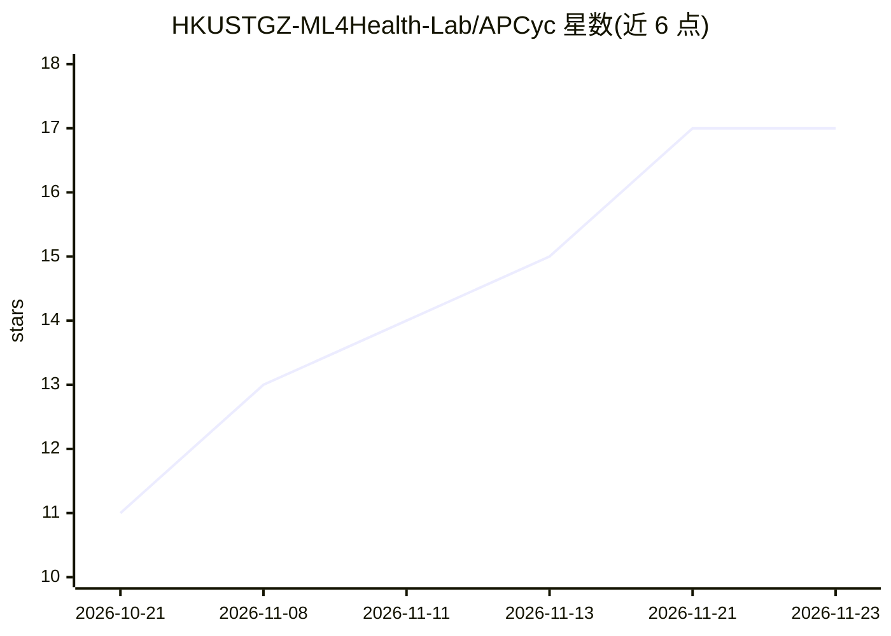

# HKUSTGZ-ML4Health-Lab/APCyc

⭐ 17 · Python · MIT · 推送 2026-11-02 · [GitHub](https://github.com/HKUSTGZ-ML4Health-Lab/APCyc) · [官网](https://hkustgz-ml4health-lab.github.io/APCyc/) · 组织维护

**给药物设计研究者：受体条件下自动环化生成环肽并按性质筛选**

面向计算药物与蛋白质设计研究者，提供受体口袋条件的环肽生成管线：基于自编码器与扩散模型训练，采样时支持解码结构引导与生成器特征引导，并附带五个性质目标（亲和力、蛋白水解稳定性、渗透性代理、溶解度、免疫原性代理）的打分与可选弛豫。预训练模型从 Hugging Face 下载（需同意访问条件，权重 MIT 许可）。测试环境为 Linux、Python 3.12、PyTorch 2.5.1，代码以 MIT 许可分发，弛豫与外部预测器需单独安装。

## 筛选速览

| 维度 | 判定 | 备注 |
|---|---|---|
| AI 角色 | `ai-native` | 本体是模型或模型工具 |
| 许可风险 | `permissive` | MIT |
| 部署形态 | `None` |  |
| 模型依赖 | — | README 未给出锁定关系 |
| 硬件要求 | — | 无带数字的原话,不猜 |
| 安装摩擦 | `medium` | 含编译或系统依赖之一 |
| 成熟度 | — | 结构信号不足 |

## 能力要点

- 自编码器+扩散模型的口袋条件环肽生成
- 自动环化预测与五种性质目标的打分引导
- Hugging Face 提供预训练生成器与性质打分模型
- 支持从零训练：AE→扩散模型→五个性质头分阶段流程

## 适用场景

- 针对特定受体口袋设计候选环肽分子
- 按亲和力与稳定性等性质目标筛选生成结果
- 复现论文实验或用自己的数据重训模型

## 场景标签

 · 领域:计算药物设计/蛋白质设计

## 证据(README 行号)

> L13: Receptor-conditioned cyclic-peptide generation with autoencoder and diffusion training, cyclization prediction, fiv
> L62: The five objectives are affinity, proteolytic stability, permeability proxy, solubility and immunogenicity proxy. T

## 星数曲线

2026-10-21 11 → 2026-11-23 17（+6）

---
*卡片 v1 · prompt 1.4 · 生成 2026-11-18 · 置信度 high · 依据 README sha `753655ac8d3c` · [字段定义](../../DATASET.md)*
