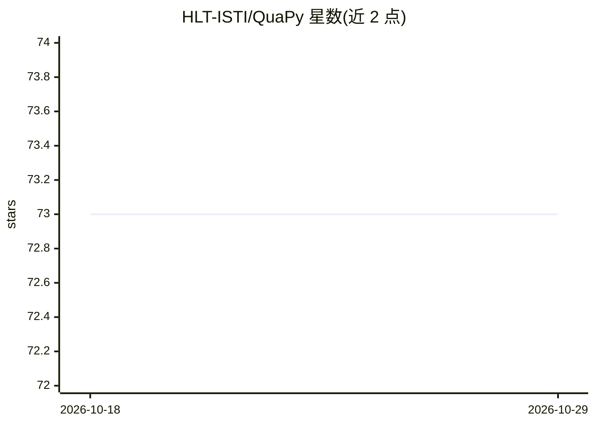

# HLT-ISTI/QuaPy

⭐ 73 · Python · BSD-3-Clause · 推送 2026-10-06 · [GitHub](https://github.com/HLT-ISTI/QuaPy) · 组织维护

**Python 量化学习框架：估计样本中的类别占比**

面向 quantification（监督式占比估计/learning to quantify）任务的开源 Python 框架。围绕“数据样本”概念组织，提供基线与进阶量化方法（Classify-&-Count 变体、EM、HDy、QuaNet、集成等）、量化导向的模型选择、多种评估指标（AE/RAE/KLD 等）与评估协议，内置 32 个 UCI 数据集、多个情感数据集及 LeQua 竞赛任务，支持自助法与贝叶斯不确定性量化，并附可视化工具。经 pip 安装，供科研与实验使用。

## 筛选速览

| 维度 | 判定 | 备注 |
|---|---|---|
| AI 角色 | `ai-native` | 本体是模型或模型工具 |
| 许可风险 | `permissive` | BSD-3-Clause |
| 部署形态 | `library` | 以包/库形式分发 |
| 模型依赖 | — | README 未给出锁定关系 |
| 硬件要求 | — | 无带数字的原话,不猜 |
| 安装摩擦 | `low` | 无编译、无系统依赖或容器化 |
| 成熟度 | — | 结构信号不足 |

## 能力要点

- 实现多种量化方法（CC 变体、EM、HDy、QuaNet、量化集成等）
- 内置 32 个 UCI 数据集与多个情感/图像/LeQua 数据集
- 提供量化导向的模型选择与 APP/NPP 等采样评估协议
- 支持自助法与贝叶斯置信区间的不确定性量化

## 适用场景

- 在类别先验偏移场景下估计测试样本的类别占比
- 复现与评测量化方法并比较评估指标
- 开展量化学习研究实验与结果可视化

## 场景标签

`科研工具` · 领域:学习与行业

## 证据(README 行号)

> L5: QuaPy is an open source framework for quantification (a.k.a. supervised prevalence estimation, or learning to quanti
> L8: QuaPy is based on the concept of "data sample", and provides implementations of the
> L63: * Implementation of many popular quantification methods (Classify-&-Count and its variants, Expectation Maximizatio

## 星数曲线

2026-10-18 73 → 2026-10-29 73（+0）

---
*卡片 v1 · prompt 1.4 · 生成 2026-10-24 · 置信度 high · 依据 README sha `87b6fb7a63d9` · [字段定义](../../DATASET.md)*
