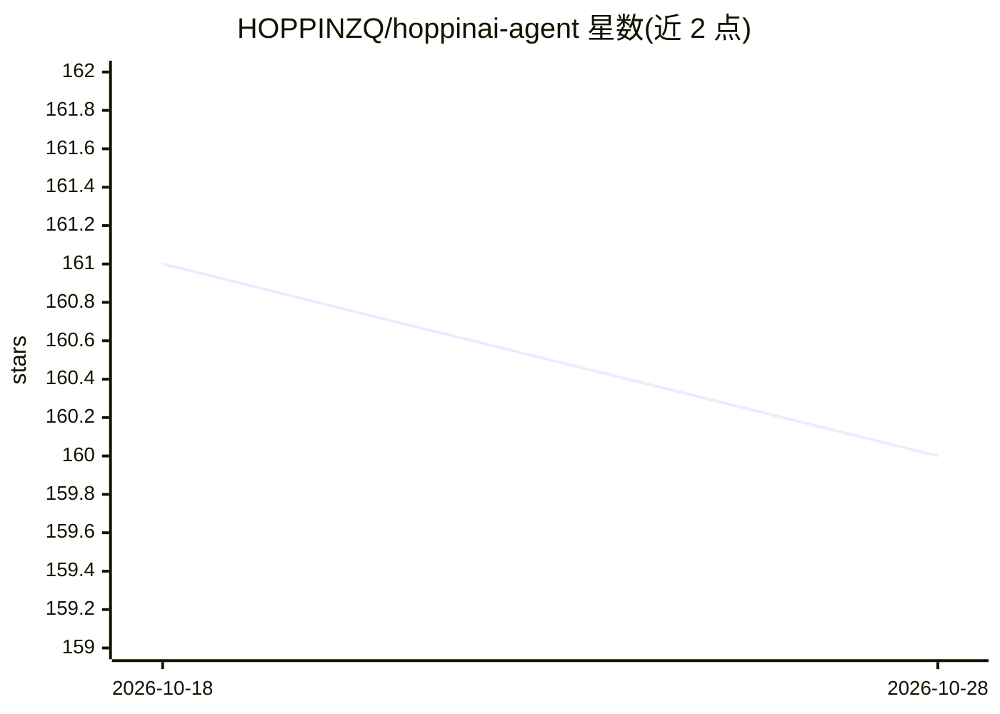

# HOPPINZQ/hoppinai-agent

⭐ 160 · Java · MIT · 推送 2026-10-15 · [GitHub](https://github.com/HOPPINZQ/hoppinai-agent) · [官网](https://hoppinzq.com/agent/index.html) · 个人维护 · 中文 README

**Java 版 AI Agent 教学项目：11 个模块从零构建类 Claude Code 系统**

基于 Anthropic Claude API 的演进式教学项目，通过 11 个 Maven 子模块逐步展示 Agent 架构：从 Bash 执行器起步，逐模块加入文件操作、SubAgent、Skill 技能注入、三层上下文压缩、DAG 任务管理、后台任务、MCP 协议（STDIO/SSE/Streamable HTTP）、ReAct 推理模式与 Spring Boot Web 服务。参考开源项目 learn-claude-code，用 Java 重写并额外提供 list_file、search_content 工具。需 JDK 17+ 与 Maven 3.8+，配置 BASE_URL/API Key 后可运行，示例配置使用 DeepSeek 的 Anthropic 兼容端点。

## 筛选速览

| 维度 | 判定 | 备注 |
|---|---|---|
| AI 角色 | `ai-knowledge` | 知识聚合/清单类 |
| 许可风险 | `permissive` | MIT |
| 部署形态 | `None` |  |
| 模型依赖 | locked-api |  |
| 硬件要求 | — | 无带数字的原话,不猜 |
| 安装摩擦 | `low` | 无编译、无系统依赖或容器化 |
| 成熟度 | — | 结构信号不足 |

## 能力要点

- 11 个递进式 Maven 子模块，统一基类 ZQAgent 提供标准 Agent 循环
- 三层上下文压缩（微压缩/自动压缩/手动压缩）
- MCP 协议支持 STDIO/SSE/Streamable HTTP 三种传输
- 两层注入的 Skill 加载与基于 DAG 的任务管理

## 适用场景

- 按模块逐步学习 AI Agent 架构的演进路径
- 参考 Java 实现构建自己的 Agent 框架
- 了解 MCP 集成与上下文压缩的落地方式

## 场景标签

`Agent 框架` `编码 Agent` `教程课程` · 领域:Agent 开发

## 证据(README 行号)

> L15: HoppinZQ Agent 是一个基于 Anthropic Claude API 构建的 AI Agent 演进式教学项目。项目通过 11 个递进式模块，从最简单的 Bash 执行器逐步演进到具备任务管理、上下文压缩、MCP 协
> L19: > 项目是完全参考开源项目 learn-claude-code。不过这个项目是基于Python，本项目：
> L54: - **递进式架构**：从单一工具调用到多工具协同，逐步引入新能力

## 星数曲线

2026-10-18 161 → 2026-10-28 160（-1）

---
*卡片 v1 · prompt 1.4 · 生成 2026-10-22 · 置信度 high · 依据 README sha `7333bd0e049b` · [字段定义](../../DATASET.md)*
