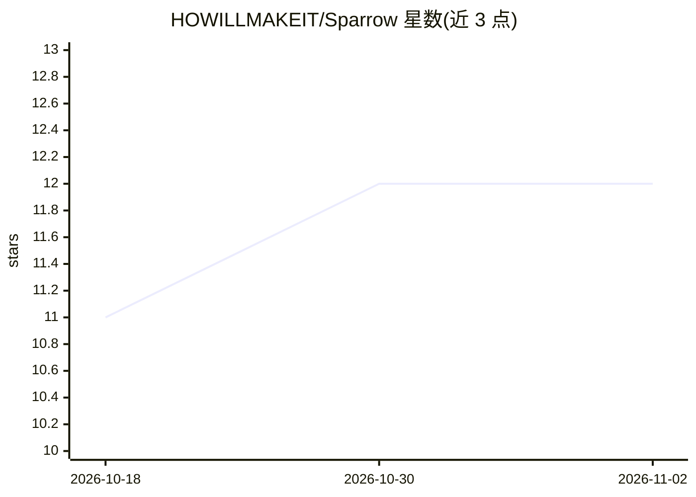

# HOWILLMAKEIT/Sparrow

⭐ 12 · Python · 推送 2026-04-09 · [GitHub](https://github.com/HOWILLMAKEIT/Sparrow) · 个人维护 · 中文 README

**给 LLM 学习者的轻量 MoE 模型三阶段训练实验项目（196M/A106M）**

基于 MiniMind 衍生的实验项目：用原生 PyTorch 实现 Decoder-only + MoE（4 专家 top-2 路由，总参 196M、激活 106M，RoPE + GQA）模型，完整覆盖 Pretrain → SFT → DPO 三阶段训练，支持单卡/多卡数据并行与 DeepSpeed ZeRO 分布式训练及断点续训。提供基于 Skywork-Reward-V2-Qwen3-8B 的自动化评测脚本和基于 Reward Model 的 DPO 数据合成方案（双 GPU 流水线并行）。README 记录了各阶段实测数据：SFT 评分提升 72.18%，DPO 后下降 5.02%（作者归因于小模型参数空间限制）。数据来自 MiniMind 数据集，需自备 GPU 环境。

## 筛选速览

| 维度 | 判定 | 备注 |
|---|---|---|
| AI 角色 | `ai-native` | 本体是模型或模型工具 |
| 许可风险 | `none` | — |
| 部署形态 | `library` | 以包/库形式分发 |
| 模型依赖 | — | README 未给出锁定关系 |
| 硬件要求 | — | 无带数字的原话,不猜 |
| 安装摩擦 | `medium` | 含编译或系统依赖之一 |
| 成熟度 | — | 结构信号不足 |

## 能力要点

- Decoder-only + MoE 架构（196M 总参/106M 激活，4 专家 top-2 路由）
- Pretrain → SFT → DPO 三阶段完整训练流程，原生 PyTorch 实现
- DeepSpeed ZeRO 分布式训练与自动 checkpoint 恢复/权重转换
- 基于 Reward Model 的自动化评测与 DPO 数据合成（双 GPU 流水线并行）

## 适用场景

- 在消费级 GPU 上实践大模型完整训练流程
- 学习 MoE 架构与 DeepSpeed 分布式训练配置
- 实验基于 Reward Model 的 DPO 数据合成与自动化评测方法

## 场景标签

`模型训练` `微调` · 领域:训练与推理

## 证据(README 行号)

> L18: **麻雀 (Sparrow)** 是一个基于 MiniMind 衍生而来的轻量级大语言模型实验项目。本项目旨在探索和实践大模型的完整训练流程，从预训练到强化学习对齐，全部采用原生 PyTorch 实现。
> L33: - **完整三阶段训练**：Pretrain → SFT → DPO，记录各阶段训练时间和资源消耗
> L39: - **架构**：Decoder-only Transformer + MoE（Mixture of Experts）

## 星数曲线

2026-10-18 11 → 2026-11-02 12（+1）

---
*卡片 v1 · prompt 1.4 · 生成 2026-11-01 · 置信度 high · 依据 README sha `29c4cecf82ab` · [字段定义](../../DATASET.md)*
