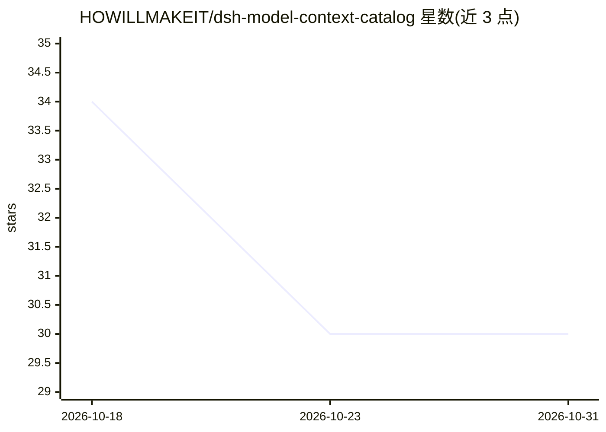

# HOWILLMAKEIT/dsh-model-context-catalog

⭐ 30 · JavaScript · MIT · 推送 2026-10-30 · [GitHub](https://github.com/HOWILLMAKEIT/dsh-model-context-catalog) · [官网](https://www.npmjs.com/package/dsh-model-context-catalog) · 个人维护 · 中文 README

**DSH 插件：一键匹配模型上下文窗口并批量配置**

dsh-model-context-catalog 是 DSH 的模型上下文配置插件：扫描 DSH 中已配置的模型，从 models.dev 模型目录与 CLIProxyAPI 接口查找上下文容量及来源，用户勾选后批量写入模型的 contextWindow；也支持已有窗口纳入管理、手动编辑与持续同步。匹配支持短名称（k3/m3）、乱序名称、别名与路由前缀，容量资料缓存 24 小时，匹配在本地完成。需要 DSH 0.2 系列与 Node.js 22+。

## 筛选速览

| 维度 | 判定 | 备注 |
|---|---|---|
| AI 角色 | `ai-ecosystem` | LLM/agent 周边工具 |
| 许可风险 | `permissive` | MIT |
| 部署形态 | `None` |  |
| 模型依赖 | — | README 未给出锁定关系 |
| 硬件要求 | — | 无带数字的原话,不猜 |
| 安装摩擦 | `low` | 无编译、无系统依赖或容器化 |
| 成熟度 | — | 结构信号不足 |

## 能力要点

- 一键匹配模型上下文窗口及容量来源，勾选后批量配置
- 从 CLIProxyAPI 接口与 models.dev 资料获取容量，缓存 24 小时
- 支持短名称、乱序名称、别名与路由前缀的模型匹配规则
- 已有窗口纳入管理、手动编辑与按条目启停同步

## 适用场景

- 为已配置的多个模型批量填写上下文窗口
- 统一管理不同服务商下同名模型的不同窗口容量
- 手动添加或修正无公开资料模型的上下文窗口

## 场景标签

 · 领域:LLM 基础设施/工具插件

## 证据(README 行号)

> L15: `dsh-model-context-catalog` 是 DSH 的模型上下文配置插件。点击 **一键匹配**，即可为模型目录中已添加的模型查找上下文容量，查看模型厂家、服务商与资料来源，勾选后批量配置，省去逐个查询和填写的工作
> L27: |**CLIProxyAPI 容量获取**|从已配置的 CLIProxyAPI 接口读取模型上下文容量，按模型 ID 匹配并展示来源|

## 星数曲线

2026-10-18 34 → 2026-10-31 30（-4）

---
*卡片 v1 · prompt 1.4 · 生成 2026-10-26 · 置信度 high · 依据 README sha `30f28249c47f` · [字段定义](../../DATASET.md)*
