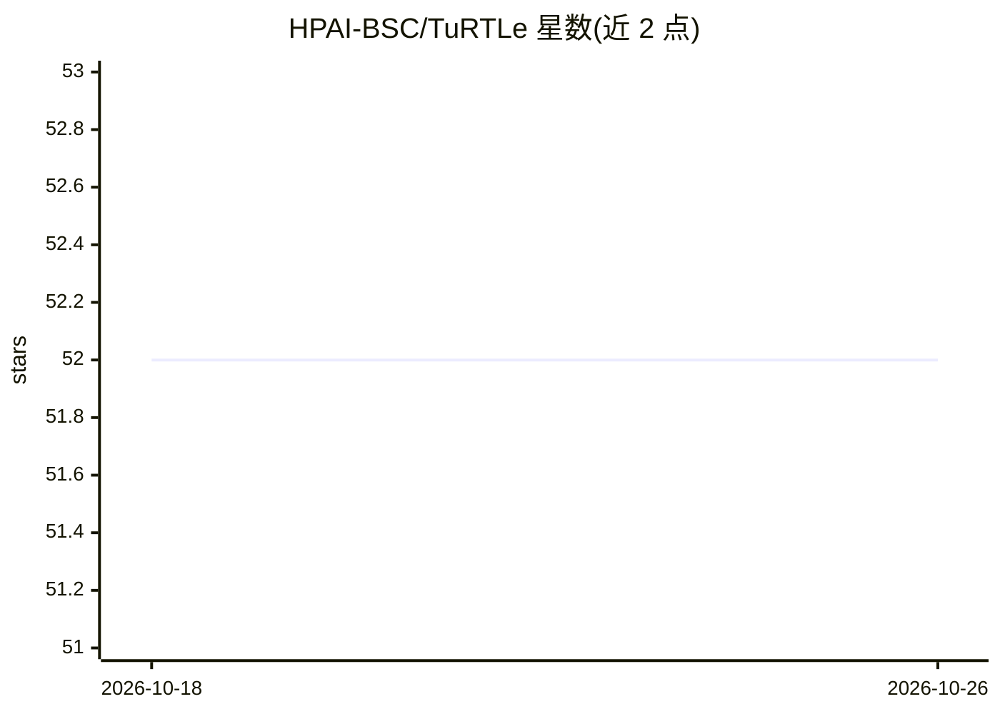

# HPAI-BSC/TuRTLe

⭐ 52 · Python · Apache-2.0 · 推送 2026-07-22 · [GitHub](https://github.com/HPAI-BSC/TuRTLe) · [官网](https://huggingface.co/spaces/HPAI-BSC/TuRTLe-Leaderboard) · 组织维护

**面向 RTL 生成任务的 LLM 统一评测框架**

由 HPAI-BSC（巴塞罗那超算中心团队）维护的 LLM 评测框架，针对 RTL（寄存器传输级）代码生成任务：整合 VerilogEval v2.0、RTLLM、VGen、RTL-Repo、NotSoTiny 等基准，自动化评测语法正确性、功能正确性、综合、PPA 优化与精确行补全。推理侧支持任意 OpenAI 兼容 API（OpenRouter/OpenAI/Azure），也可用 vLLM 在 GPU 集群做多节点推理；评测侧通过 Docker 镜像打包 Icarus Verilog、Verilator、Yosys、LibreLane 等 EDA 工具本地运行。提供 Hugging Face 排行榜，配套论文发表于 MLCAD 2025 与 ACM TODAES 2026。

## 筛选速览

| 维度 | 判定 | 备注 |
|---|---|---|
| AI 角色 | `ai-ecosystem` | LLM/agent 周边工具 |
| 许可风险 | `permissive` | Apache-2.0 |
| 部署形态 | `self-host` | docker 或自建部署 |
| 模型依赖 | local-ok | 支持本地模型 |
| 硬件要求 | — | 无带数字的原话,不猜 |
| 安装摩擦 | `low` | 无编译、无系统依赖或容器化 |
| 成熟度 | — | 结构信号不足 |

## 能力要点

- 整合 5+ 个 RTL 生成基准，覆盖 STX/FNC/SYN/EQV/PPA 多维评测
- 基于 Docker 的本地 EDA 工具链评测（Icarus Verilog/Verilator/Yosys/LibreLane）
- 支持 OpenAI 兼容 API 推理与 vLLM 多节点集群推理
- 提供新增自定义基准的模板化扩展流程

## 适用场景

- 统一评测各 LLM 在 Verilog/RTL 生成任务上的表现
- 在本地可复现环境中跑通语法、功能与综合指标评测
- 为芯片设计流程筛选适合 RTL 生成的开源模型

## 场景标签

`模型评测` · 领域:评测与运维

## 证据(README 行号)

> L19: TuRTLe is a framework to assess LLMs across key RTL generation tasks systematically. It integrates multiple existin
> L55: TuRTLe supports API-based inference which works out of the box with any OpenAI-compatible API (OpenRouter, OpenAI, 

## 星数曲线

2026-10-18 52 → 2026-10-26 52（+0）

---
*卡片 v1 · prompt 1.4 · 生成 2026-10-24 · 置信度 high · 依据 README sha `a09d84558244` · [字段定义](../../DATASET.md)*
