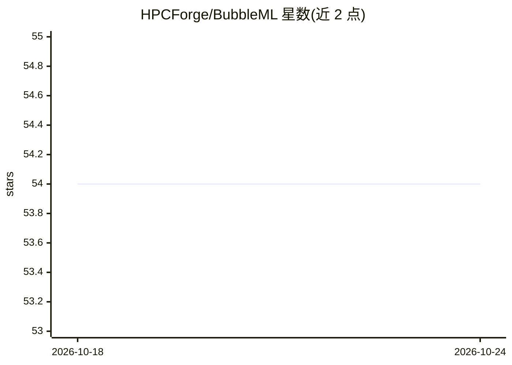

# HPCForge/BubbleML

⭐ 54 · Python · 推送 2026-02-02 · [GitHub](https://github.com/HPCForge/BubbleML) · [官网](https://openreview.net/forum?id=0Wmglu8zak) · 组织维护

**沸腾多相多物理场仿真数据集与科学机器学习基准（NeurIPS 2023）**

面向热科学与科学机器学习社区的多相沸腾过程仿真数据集：模拟场景覆盖液体流经 GPU 的数据中心液冷、核废料冷却池等，可用于训练神经算子等模型。提供 Jupyter Notebook 示例展示数据加载、张量读取与 Fourier Neural Operator 训练；提供基于 Flash-X 的可复现实验包供用户生成自己的沸腾仿真；模型检查点列于 model zoo，并含光流基准。限制：当前每项研究仅变化单一参数，多参数变化需自行扩展仿真。附后续工作 Bubbleformer（NeurIPS 2025 Spotlight）及 Hugging Face 上的 BubbleML 2.0 数据集。

## 筛选速览

| 维度 | 判定 | 备注 |
|---|---|---|
| AI 角色 | `ai-knowledge` | 知识聚合/清单类 |
| 许可风险 | `none` | — |
| 部署形态 | `None` |  |
| 模型依赖 | — | README 未给出锁定关系 |
| 硬件要求 | — | 无带数字的原话,不猜 |
| 安装摩擦 | `low` | 无编译、无系统依赖或容器化 |
| 成熟度 | — | 结构信号不足 |

## 能力要点

- 多相多物理场沸腾仿真数据集，NeurIPS 2023 Spotlight 论文
- 示例 Notebook 覆盖数据加载、可视化与 Fourier Neural Operator 训练
- 提供 Flash-X 可复现实验包供用户生成自定义沸腾仿真
- 发布模型检查点 model zoo 与光流基准

## 适用场景

- 研究多相数据、复杂边界条件与长程自回归稳定性的科学 ML 挑战
- 训练神经算子或神经 PDE 求解器用于沸腾/热管理仿真
- 为数据中心液冷等热科学问题构建数据驱动模型

## 场景标签

`模型评测` · 领域:评测与运维

## 证据(README 行号)

> L4: A multiphase, multiphysics dataset of boiling processes. These simulations can be used to model datacenter cooling s
> L8: We hope that BubbleML will be useful to members of the Thermal Science community who are interested in exploring and

## 星数曲线

2026-10-18 54 → 2026-10-24 54（+0）

---
*卡片 v1 · prompt 1.4 · 生成 2026-10-24 · 置信度 high · 依据 README sha `2c8c949190b4` · [字段定义](../../DATASET.md)*
