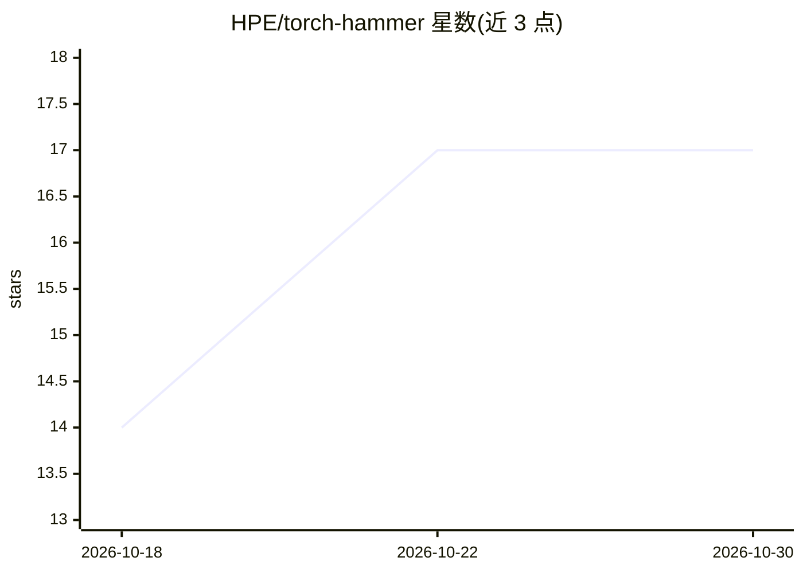

# HPE/torch-hammer

⭐ 17 · Python · Apache-2.0 · 推送 2026-10-19 · [GitHub](https://github.com/HPE/torch-hammer) · 组织维护

**面向 CPU/GPU/APU 的 PyTorch 微基准压测套件**

HPE 维护的跨平台硬件压测与性能评估工具：基于 PyTorch 提供 9 种微基准（批处理 GEMM、2D 卷积、3D FFT、Einsum、随机内存访问、热传导、薛定谔方程求解、L2 缓存原子竞争、稀疏矩阵乘），支持 CUDA/ROCm/MPS/CPU 自动选择与多种精度，采集 NVIDIA/AMD 遥测数据（功率、温度、时钟等），含 TIM 老化的 Melt 模式、多 GPU 并行、NUMA 绑核、CSV/JSON/syslog 输出与基线校验。已在 50+ 硬件配置上验证，git clone 源码运行，默认参数面向 80GB+ 显存 GPU。

## 筛选速览

| 维度 | 判定 | 备注 |
|---|---|---|
| AI 角色 | `ai-enhanced` | 去掉 AI 部分产品仍成立 |
| 许可风险 | `permissive` | Apache-2.0 |
| 部署形态 | `library` | 以包/库形式分发 |
| 模型依赖 | — | README 未给出锁定关系 |
| 硬件要求 | `cpu-ok` | |
| 安装摩擦 | `medium` | 含编译或系统依赖之一 |
| 成熟度 | — | 结构信号不足 |

## 能力要点

- 9 种 PyTorch 微基准覆盖 GEMM/卷积/FFT/稀疏矩阵等负载
- CUDA、ROCm、Metal (MPS)、CPU 跨平台自动选择
- Melt 模式通过 GEMM 热循环判定 GPU 导热界面材料是否 settled
- NVIDIA/AMD 实时遥测与多 GPU 异常检测、基线性能校验

## 适用场景

- 新到货 GPU/CPU 服务器做压力测试与性能表征
- 集群部署前识别慢件或异常硬件
- 维修后 GPU 模块通过 Melt 模式确认 TIM 沉降状态

## 场景标签

 · 领域:硬件基准测试/HPC 运维

## 证据(README 行号)

> L16: _A portable, PyTorch micro-benchmark suite for stress testing CPUs, GPUs, and APUs_
> L22: Torch Hammer is a benchmarking utility designed to stress test and evaluate the performance of CPUs, GPUs, and APUs

## 星数曲线

2026-10-18 14 → 2026-10-30 17（+3）

---
*卡片 v1 · prompt 1.4 · 生成 2026-10-30 · 置信度 mid · 依据 README sha `49bf9cf35e56` · [字段定义](../../DATASET.md)*
