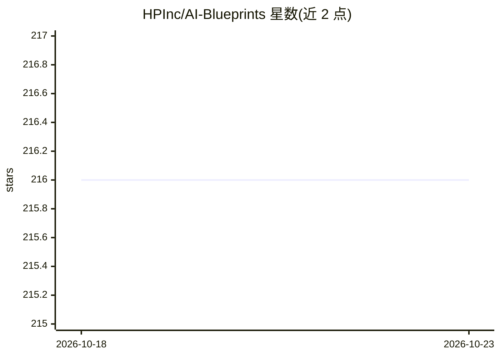

# HPInc/AI-Blueprints

⭐ 216 · Jupyter Notebook · MIT · 推送 2026-10-12 · [GitHub](https://github.com/HPInc/AI-Blueprints) · [官网](https://hp.com/ai-studio) · 组织维护

**HP 维护的本地 AI 蓝图项目集：20+ 端到端示例工程**

HP AI Studio 团队维护的 AI 蓝图项目集合，包含 20 余个端到端示例，以 Jupyter notebook、MLflow 部署和 Streamlit 应用形式运行，覆盖数据科学（SVM、回归）、深度学习（图像分类、BERT QA）、生成式 AI（RAG、微调、Stable Diffusion、代码生成）及 NVIDIA GPU Cloud 集成（TensorRT-LLM、NeMo、cuDF）等方向。项目使用本地开源模型（LLaMA、Qwen、BERT、LLaMA Nemotron），部分示例搭配 Hugging Face 托管模型。运行需下载 HP AI Studio 并创建免费账户；各项目 README 含推荐最低硬件规格。

## 筛选速览

| 维度 | 判定 | 备注 |
|---|---|---|
| AI 角色 | `ai-knowledge` | 知识聚合/清单类 |
| 许可风险 | `permissive` | MIT |
| 部署形态 | `None` |  |
| 模型依赖 | — | README 未给出锁定关系 |
| 硬件要求 | — | 无带数字的原话,不猜 |
| 安装摩擦 | `medium` | 含编译或系统依赖之一 |
| 成熟度 | — | 结构信号不足 |

## 能力要点

- 20+ 即用型蓝图项目，覆盖数据科学/深度学习/生成式 AI/NGC 集成四类
- 使用本地开源模型（LLaMA、Qwen、BERT、LLaMA Nemotron），部分步骤经 llama.cpp 本地推理
- 示例整合 MLflow 部署、Streamlit 前端与 LangChain/LangGraph 流程编排
- 5 个 NVIDIA NGC 集成项目（TensorRT-LLM、NeMo、cuDF 等 GPU 加速示例）

## 适用场景

- 我需要在 HP AI Studio 里找现成的 RAG / 微调 / 图像分类项目模板
- 我想参考端到端的 Agentic RAG 与音频翻译 GPU 流水线实现
- 我想对比 CPU Pandas 与 GPU cuDF 的数据处理性能

## 场景标签

`数据分析` `图像生成` `RAG` `微调` · 领域:效率与自动化

## 证据(README 行号)

> L16: This repository hosts a growing collection of AI blueprint projects that run end-to-end using Jupyter notebooks, ML
> L122: - Generates scores locally via `llama.cpp` (no data leaves your machine)

## 星数曲线

2026-10-18 216 → 2026-10-23 216（+0）

---
*卡片 v1 · prompt 1.4 · 生成 2026-10-22 · 置信度 high · 依据 README sha `7e391bcb7a56` · [字段定义](../../DATASET.md)*
