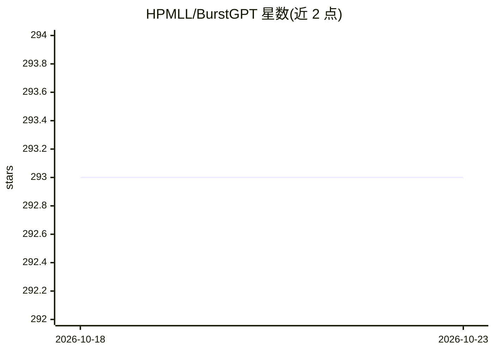

# HPMLL/BurstGPT

⭐ 293 · Python · CC-BY-4.0 · 推送 2026-06-30 · [GitHub](https://github.com/HPMLL/BurstGPT) · 组织维护

**真实 ChatGPT/GPT-4 请求负载追踪数据集，用于 LLM serving 研究**

面向科研与学术社区发布的 LLM serving 真实负载数据集：记录 ChatGPT(GPT-3.5) 与 GPT-4 的请求（Azure 托管服务），Release v2.0 含 6 个 CSV 文件，覆盖约 121 天与 110 天时段、共约千万行。字段含时间戳、Session ID、耗时、模型名、请求/响应 token 数与调用方式（对话/API）。提供含失败（响应 token 为 0）与去失败两种版本，并附请求生成器示例；使用需引用对应论文。

## 筛选速览

| 维度 | 判定 | 备注 |
|---|---|---|
| AI 角色 | `ai-knowledge` | 知识聚合/清单类 |
| 许可风险 | `viral` | CC-BY-4.0 |
| 部署形态 | `None` |  |
| 模型依赖 | — | README 未给出锁定关系 |
| 硬件要求 | — | 无带数字的原话,不猜 |
| 安装摩擦 | `low` | 无编译、无系统依赖或容器化 |
| 成熟度 | — | 结构信号不足 |

## 能力要点

- 覆盖 ChatGPT(GPT-3.5) 与 GPT-4 的真实请求 trace（Azure 托管）
- 6 个 CSV 文件，单文件最大 5344.0k 行，含失败与去失败双版本
- 字段含 Session ID、Elapsed time、请求/响应 token 数、调用方式
- 附简单请求生成器示例（example/）

## 适用场景

- 为 LLM serving 系统做负载仿真与评测
- 按论文方法对 trace 建模并缩放参数做压力测试
- 研究 LLM 请求的周期性与流量模式

## 场景标签

`科研工具` `模型评测` · 领域:评测与运维

## 证据(README 行号)

> L6: This repository contains public releases of a real-world trace dataset of LLM serving workloads for the benefit of t
> L23: There are currently 6 files in Release v2.0:

## 星数曲线

2026-10-18 293 → 2026-10-23 293（+0）

---
*卡片 v1 · prompt 1.4 · 生成 2026-10-23 · 置信度 high · 依据 README sha `f815564f95ba` · [字段定义](../../DATASET.md)*
