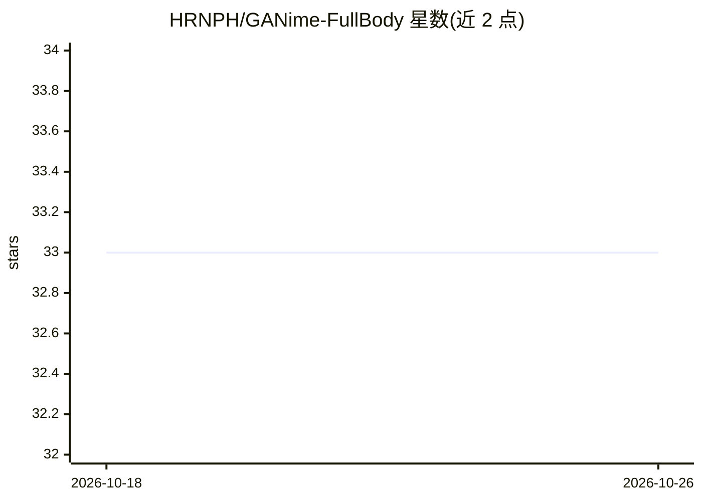

# HRNPH/GANime-FullBody

⭐ 33 · Jupyter Notebook · GPL-3.0 · 推送 2025-11-14 · [GitHub](https://github.com/HRNPH/GANime-FullBody) · [官网](https://hrnph.github.io/GANime-FullBody/) · 个人维护 · 中文 README

**扩散模型之前时代的动漫全身立绘 GAN 生成实验项目**

个人研究/开发日志形式的 GAN 项目：目标是生成全身动漫角色立绘，用途包括游戏开发占位素材。README 记录了完整过程——用现成爬虫从 Safebooru 按 full_body solo standing 1girl white_background 标签爬取约 2 万张图，训练 VGG16 迁移学习分类器自动过滤 chibi 与多角色图，再人工清洗至 1 万张；随后依次实验 DCGAN、WGAN-GP、ProGAN、StyleGAN 架构，StyleGAN 在 64x64 分辨率、latent size 512 下得到可用结果。提供清洗后数据集的 Google Drive 链接，README 为研究记录，未见成型的安装运行说明。

## 筛选速览

| 维度 | 判定 | 备注 |
|---|---|---|
| AI 角色 | `ai-native` | 本体是模型或模型工具 |
| 许可风险 | `viral` | GPL-3.0 |
| 部署形态 | `None` |  |
| 模型依赖 | — | README 未给出锁定关系 |
| 硬件要求 | `gpu-8g` | |
| 安装摩擦 | `low` | 无编译、无系统依赖或容器化 |
| 成熟度 | — | 结构信号不足 |

## 能力要点

- 依次实验 DCGAN / WGAN-GP / ProGAN / StyleGAN 四种架构
- VGG16 迁移学习分类器自动过滤 chibi 与 not_single 图像（Chibi 分类达 98% 准确率）
- 自建并清洗 1 万张全身白底动漫角色数据集，公开于 Google Drive

## 适用场景

- 获取游戏开发用的动漫全身立绘占位素材
- 参考全身动漫角色 GAN 训练的数据清洗与架构选型过程
- 下载已清洗的全身白底动漫角色数据集用于自己的实验

## 场景标签

`图像生成` · 领域:内容生成

## 证据(README 行号)

> L5: Full body Generation of anime girls
> L54: in this project, we'll work on dcgans, wgan-gp, progans, stylegans
> L332: # Trainning

## 星数曲线

2026-10-18 33 → 2026-10-26 33（+0）

---
*卡片 v1 · prompt 1.4 · 生成 2026-10-25 · 置信度 high · 依据 README sha `1962268f74c7` · [字段定义](../../DATASET.md)*
