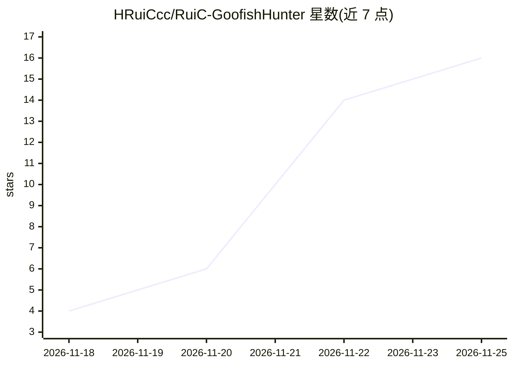

# HRuiCcc/RuiC-GoofishHunter

⭐ 16 · Python · MIT · 推送 2026-11-15 · [GitHub](https://github.com/HRuiCcc/RuiC-GoofishHunter) · 个人维护 · 中文 README

**给闲鱼买家做可解释捡漏打分与监控的本地工具**

跑在本机的闲鱼捡漏决策台：每 5 分钟扫描关键词，用页面驱动抓取加响应拦截取数，按价格/成色/卖家/风险拆分的 0–100 规则分给出可解释判断，过线商品去重推送。AI 仅对头部候选做补充复核，默认接 DeepSeek，也可填 OpenAI 兼容接口，不配 key 时整条链路仍可用。FastAPI + Vue3 实现，SQLite 存储登录态与数据，支持无头后台运行（macOS 提供 launchd 服务脚本）。README 声明仅供学习研究。

## 筛选速览

| 维度 | 判定 | 备注 |
|---|---|---|
| AI 角色 | `ai-native` | 本体是模型或模型工具 |
| 许可风险 | `permissive` | MIT |
| 部署形态 | `None` |  |
| 模型依赖 | locked-api |  |
| 硬件要求 | — | 无带数字的原话,不猜 |
| 安装摩擦 | `low` | 无编译、无系统依赖或容器化 |
| 成熟度 | — | 结构信号不足 |

## 能力要点

- 可解释规则打分（价格/成色/卖家/风险逐项可见，0–100 分档）
- 按存储容量分桶的同规格中位价做市场基准
- AI 仅复核头部候选，不配 key 也能完整使用
- 页面驱动抓取 + 响应拦截，无头后台静默运行

## 适用场景

- 监控指定关键词的闲鱼商品并及时收到过线提示
- 在购买前看某件二手商品的分数构成和值得问的问题
- 学习页面驱动抓取与响应拦截的接口分析

## 场景标签

`网页抓取` `数据分析` · 领域:效率与自动化

## 证据(README 行号)

> L5: 一个跑在自己电脑上的闲鱼捡漏决策台：每 5 分钟扫一遍你关心的关键词，
> L11: 重点不在多抓几条，而在判断：抓取走页面驱动 + 响应拦截，判断走可解释的规则分，
> L18: - **判断**：规则分先行（0–100，可解释），AI 只复核头部候选。没配 key 也能完整使用。

## 星数曲线

2026-11-18 4 → 2026-11-25 16（+12）

---
*卡片 v1 · prompt 1.4 · 生成 2026-11-20 · 置信度 high · 依据 README sha `f24129ef80d1` · [字段定义](../../DATASET.md)*
