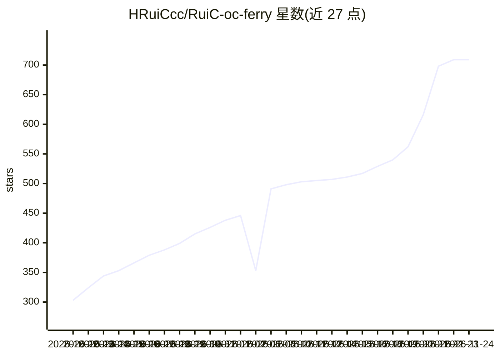

# HRuiCcc/RuiC-oc-ferry

⭐ 721 · JavaScript · MIT · 推送 2026-11-01 · [GitHub](https://github.com/HRuiCcc/RuiC-oc-ferry) · 个人维护 · 中文 README

**把 OpenCode 免费模型转发给 WorkBuddy/DSH 的托盘工具**

基于 Electron 的托盘应用：在数据目录放一份隔离的 OpenCode 运行时，按价格字段筛出免费模型，逐个并发探测其能否按客户端工具协议产生动作，将通过的写入 WorkBuddy 的 models.json 或 DSH 各 profile 的 cordis.patch.yml，并提供仅监听本机的 OpenAI 兼容转发口（/v1/chat/completions，支持 stream，并发上限 4）。判定结果按模型缓存（成功保留 6 小时），写入前备份、原子替换，退出时清理自己写入的条目。执行权保留在客户端，模型本机动作被拒绝或转交为外部工具调用。

## 筛选速览

| 维度 | 判定 | 备注 |
|---|---|---|
| AI 角色 | `ai-ecosystem` | LLM/agent 周边工具 |
| 许可风险 | `permissive` | MIT |
| 部署形态 | `desktop` | 安装包/桌面程序 |
| 模型依赖 | — | README 未给出锁定关系 |
| 硬件要求 | — | 无带数字的原话,不猜 |
| 安装摩擦 | `low` | 无编译、无系统依赖或容器化 |
| 成熟度 | — | 结构信号不足 |

## 能力要点

- 隔离 OpenCode 运行时 + 按价格字段（非名字）筛选免费模型
- 并发检测工具协议可用性，判定按模型缓存（成功 6 小时）
- 一键写入 WorkBuddy models.json / DSH cordis.patch.yml，写入前备份、退出时清理
- 本机 OpenAI 兼容转发口，Bearer 鉴权，拒绝带 Origin 的浏览器请求

## 适用场景

- 让 WorkBuddy 直接使用 OpenCode 免费模型池
- 给 DSH 各 profile 批量写入可用免费模型
- 在本机以 OpenAI 兼容接口调用免费模型

## 场景标签

`模型网关` · 领域:Agent 开发

## 证据(README 行号)

> L15: **OC Ferry 就是中间这一层**：在数据目录里放一份**隔离的** OpenCode，按**价格**筛出免费模型，逐个探测它们能不能按客户端的工具协议干活，把通过的写进 WorkBuddy 的 `models.json` 
> L43: 5. **转发**：模型只能回一个 JSON 信封表达动作，**执行权始终在客户端手里**——任何本机动作一律被拒绝或转交成外部工具调用，模型永远不会自己动手。

## 星数曲线

2026-10-22 303 → 2026-11-24 709（+406）

---
*卡片 v1 · prompt 1.4 · 生成 2026-11-24 · 置信度 high · 依据 README sha `4c8c3a524a55` · [字段定义](../../DATASET.md)*
