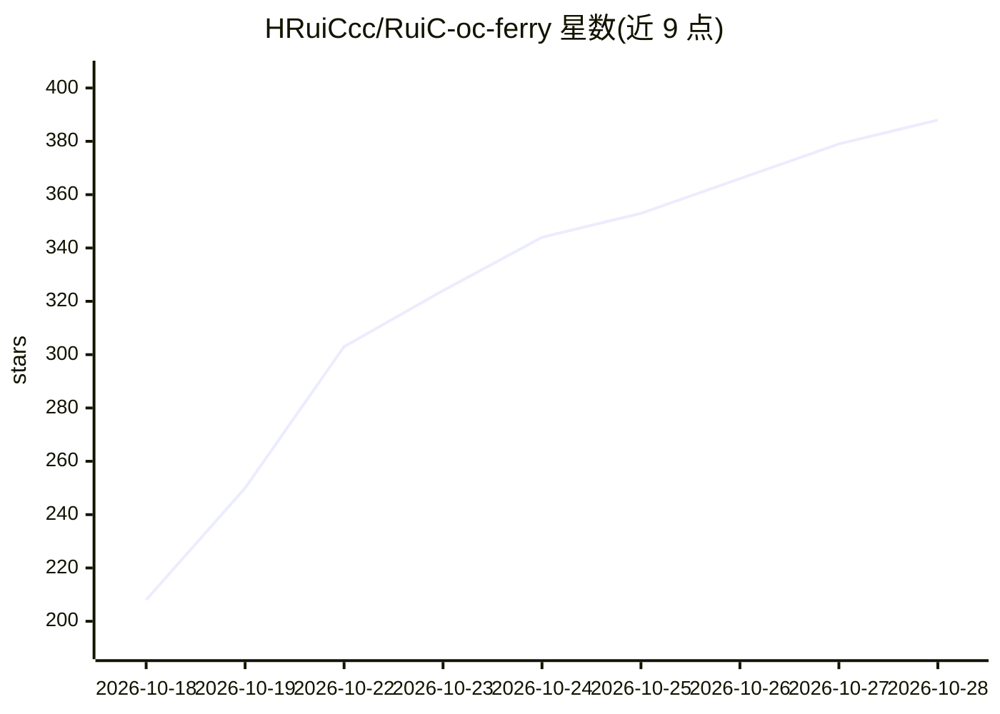

# HRuiCcc/RuiC-oc-ferry

⭐ 388 · JavaScript · MIT · 推送 2026-10-26 · [GitHub](https://github.com/HRuiCcc/RuiC-oc-ferry) · 个人维护 · 中文 README

**把 OpenCode 免费模型探测后摆渡给 WorkBuddy 的托盘应用**

跨平台 Electron 托盘应用：在数据目录内放置隔离的 OpenCode 运行时，按价格字段筛出免费模型，用 5 个工具与随机 token 文件逐个探测能否按 WorkBuddy 工具协议产生动作，3 路并发检测并缓存判定（成功 6 小时、负载 10 分钟），通过后写入 WorkBuddy 的 models.json，并在本机 41980 端口提供需 Bearer 鉴权的 OpenAI 兼容转发口。模型动作仅以 JSON 信封表达，执行权保留在 WorkBuddy。macOS/Windows 提供安装包，Linux 为实验性；系统代理仅支持手动 HTTP/HTTPS。

## 筛选速览

| 维度 | 判定 | 备注 |
|---|---|---|
| AI 角色 | `ai-ecosystem` | LLM/agent 周边工具 |
| 许可风险 | `permissive` | MIT |
| 部署形态 | `desktop` | 安装包/桌面程序 |
| 模型依赖 | — | README 未给出锁定关系 |
| 硬件要求 | — | 无带数字的原话,不猜 |
| 安装摩擦 | `low` | 无编译、无系统依赖或容器化 |
| 成熟度 | `idea` | |

## 能力要点

- 按价格字段（输入/输出/缓存全为 0）判定免费并逐个探测工具调用能力
- 3 路并发检测与分级判定缓存（成功 6 小时/负载 10 分钟）
- 写 WorkBuddy models.json 时备份、加锁、原子替换，只动自己标记的条目
- 本机 OpenAI 兼容转发口（Bearer 鉴权、拒绝带 Origin 请求、支持 stream）

## 适用场景

- 我想让 WorkBuddy 直接用上 OpenCode 的免费模型额度
- 筛选出真正能按工具协议工作的免费模型并自动导入配置
- 开机常驻托盘保持免费模型可用

## 场景标签

`模型网关` · 领域:Agent 开发

## 证据(README 行号)

> L13: **OC Ferry 就是中间这一层**：在数据目录里放一份**隔离的** OpenCode，按**价格**筛出免费模型，逐个探测它们能不能按 WorkBuddy 的工具协议干活，把通过的写进你的 `models.json`，再起
> L89: POST /v1/chat/completions    # 转发，支持 stream；并发上限 4

## 星数曲线

2026-10-18 208 → 2026-10-28 388（+180）

---
*卡片 v1 · prompt 1.4 · 生成 2026-10-21 · 置信度 high · 依据 README sha `d421407ebf24` · [字段定义](../../DATASET.md)*
