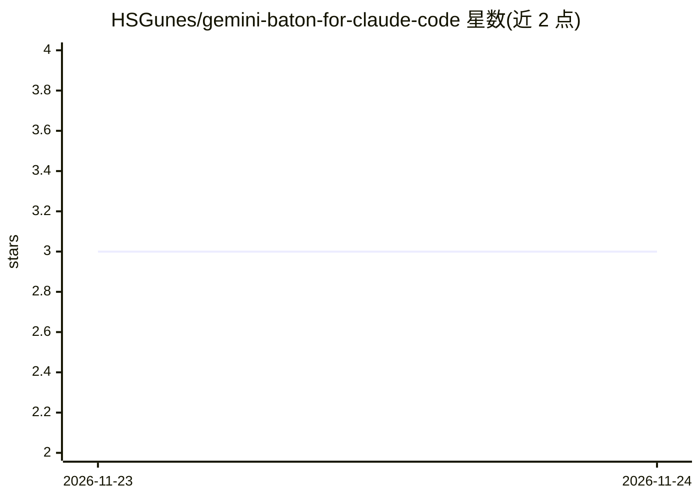

# HSGunes/gemini-baton-for-claude-code

⭐ 3 · Python · MIT · 推送 2026-11-19 · [GitHub](https://github.com/HSGunes/gemini-baton-for-claude-code) · 个人维护

**Claude Code 插件：把编码任务委派给 Gemini 子代理执行，Claude 负责规划与验证**

以 Claude Code 插件形式分发，核心是一个零依赖的 Python 3.10+ 单文件 CLI（baton），通过 Google Antigravity CLI（agy）在后台驱动 Gemini 完成编码任务。工作流为：Claude 撰写任务与验收标准，Gemini 实现，Claude 用用户自己的测试验证，失败则回到同一 Gemini 会话继续修复（默认最多 3 轮）。任务支持后台运行、写权限白名单、默认沙箱（终端命令禁用）与任务状态管理。要求本地已登录的 agy，仅支持 Linux/macOS，不支持 Windows。子命令以土耳其语命名并提供英文别名。

## 筛选速览

| 维度 | 判定 | 备注 |
|---|---|---|
| AI 角色 | `ai-ecosystem` | LLM/agent 周边工具 |
| 许可风险 | `permissive` | MIT |
| 部署形态 | `library` | 以包/库形式分发 |
| 模型依赖 | — | README 未给出锁定关系 |
| 硬件要求 | — | 无带数字的原话,不猜 |
| 安装摩擦 | `low` | 无编译、无系统依赖或容器化 |
| 成熟度 | — | 结构信号不足 |

## 能力要点

- 任务后台运行与多任务并行启动，状态可查询与续接会话
- 以用户自有测试做验证，失败自动回传 Gemini 修复（默认 3 轮）
- 写权限白名单与默认沙箱，权限缺失时提前退出
- 零依赖单文件 Python 实现，附 65 个针对假 agy 的测试

## 适用场景

- 把耗 token 的编码实现工作转移到 Gemini 配额上执行
- 在 Claude Code 里并行委派多个互不冲突的编码任务
- 要求 Gemini 修改后自动跑测试并循环修复直至通过

## 场景标签

`编码 Agent` `多智能体` · 领域:Agent 开发

## 证据(README 行号)

> L6: Gemini Baton is a Claude Code plugin that hands coding tasks to a Gemini sub-agent (through Google's `agy` / Antigra
> L8: Claude writes the task and acceptance criteria. Gemini implements it in the background, and Claude then runs **your*

## 星数曲线

2026-11-23 3 → 2026-11-24 3（+0）

---
*卡片 v1 · prompt 1.4 · 生成 2026-11-23 · 置信度 high · 依据 README sha `7bdb4668791b` · [字段定义](../../DATASET.md)*
