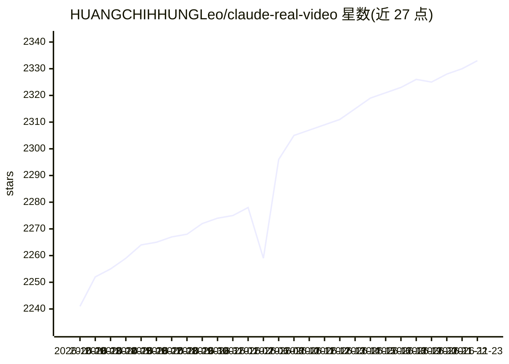

# HUANGCHIHHUNGLeo/claude-real-video

⭐ 2,333 · Python · MIT · 推送 2026-11-20 · [GitHub](https://github.com/HUANGCHIHHUNGLeo/claude-real-video) · [官网](https://leoaido.com/crv-pro/) · 个人维护 · 中文 README

**让 Claude/LLM 真正读取视频的本地帧+转录提取 CLI**

crv 是一个本地运行的 Python CLI/Web 工具：对 URL（YouTube/Reels/TikTok）或本地视频做场景变化检测取帧、滑窗去重、音频转录（Whisper/faster-whisper/mlx-whisper）与字幕/OCR 辅助文本锚点，输出帧图、带时间戳的 transcript 和 MANIFEST，供粘贴给任意 LLM 提问。处理全部在本机完成，视频不上传；可选 --from/--to 时间窗、--speakers 说话人分离、--why 意图聚焦。面向 Claude Code/Cursor/Codex 等 agent 用户及普通终端使用者，另以 crv Pro（付费附加）提供镜头语言与时间线分析、Codex 专用构建。

## 筛选速览

| 维度 | 判定 | 备注 |
|---|---|---|
| AI 角色 | `ai-native` | 本体是模型或模型工具 |
| 许可风险 | `permissive` | MIT |
| 部署形态 | `library` | 以包/库形式分发 |
| 模型依赖 | — | README 未给出锁定关系 |
| 硬件要求 | — | 无带数字的原话,不猜 |
| 安装摩擦 | `medium` | 含编译或系统依赖之一 |
| 成熟度 | — | 结构信号不足 |

## 能力要点

- 场景变化检测取帧+去重，替代固定 1fps 采样，减少 token 消耗
- 本地转录支持 whisper、faster-whisper（Silero VAD 门控）、mlx-whisper（Apple Silicon GPU）
- npx skills add 一条命令安装技能到 Claude Code/Cursor/Codex/Copilot/Gemini CLI 等 50+ agent 宿主
- 提供 crv-web 本地网页界面（繁/简中文、英文）与 --viewer 本地查看器

## 适用场景

- 让 Claude 分析 YouTube/短视频链接或本地视频内容
- 会议录屏只取关键时间窗的帧与逐字稿
- 给 agent 安装看视频技能后直接粘贴链接提问
- 独立用作通用视频关键帧提取器（无需下载 ML 模型）

## 场景标签

`语音识别` `图像视频处理` · 领域:感知与多模态

## 证据(README 行号)

> L17: **Let Claude — or any LLM — actually watch a video.**
> L50: `claude-real-video` does it differently, and **the processing runs locally**: point it at a URL or a
> L161: pip install "claude-real-video[whisper]"   # recommended: frames + dedup + audio transcription

## 星数曲线

2026-10-20 2,241 → 2026-11-23 2,333（+92）

---
*卡片 v1 · prompt 1.4 · 生成 2026-11-23 · 置信度 high · 依据 README sha `e2041989b0fe` · [字段定义](../../DATASET.md)*
