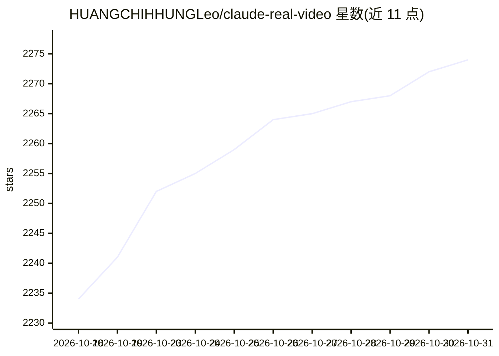

# HUANGCHIHHUNGLeo/claude-real-video

⭐ 2,274 · Python · MIT · 推送 2026-10-23 · [GitHub](https://github.com/HUANGCHIHHUNGLeo/claude-real-video) · [官网](https://leoaido.com/crv-pro/) · 个人维护 · 中文 README

**本地视频转关键帧+字幕转录工具，让 LLM 能"看"视频**

Python 包（crv），从 URL 或本地视频提取场景变化关键帧、去重、用 Whisper/faster-whisper 转录音频，输出 frames/*.jpg、frames.json、transcript 与 MANIFEST.TXT，供粘贴给任意 LLM 使用。处理全部在本地运行，无需 API key。支持时间窗截取、说话人分离、字幕锚定帧、--grid 拼接图等选项；另提供 crv-web 本地网页界面与 Claude Code/Codex 等 agent 技能安装命令。帧提取无 ML 模型依赖，转录需安装 [whisper] extra；系统需 ffmpeg。有付费版 crv Pro（Capafy 销售）。

## 筛选速览

| 维度 | 判定 | 备注 |
|---|---|---|
| AI 角色 | `ai-native` | 本体是模型或模型工具 |
| 许可风险 | `permissive` | MIT |
| 部署形态 | `library` | 以包/库形式分发 |
| 模型依赖 | — | README 未给出锁定关系 |
| 硬件要求 | — | 无带数字的原话,不猜 |
| 安装摩擦 | `medium` | 含编译或系统依赖之一 |
| 成熟度 | — | 结构信号不足 |

## 能力要点

- 场景变化检测选帧+滑窗去重，替代固定间隔采样
- 本地 Whisper/faster-whisper 转录，含 VAD 防幻听与 Apple Silicon GPU 加速
- 支持 yt-dlp URL 输入、--from/--to 时间窗、说话人分离、--grid 接触表
- 可一键安装为 Claude Code/Cursor/Codex/Copilot 等 agent 技能

## 适用场景

- 把视频链接变成帧+转录文件交给 Claude/ChatGPT 提问
- 长会议录像中截取关键片段做 LLM 分析
- 作为通用视频关键帧提取器（不带转录）使用

## 场景标签

`语音识别` `多模态` · 领域:感知与多模态

## 证据(README 行号)

> L52: fixed quota), throws away the near-duplicates, transcribes the audio, and hands
> L179: Transcription uses the `whisper` CLI (installed by the `[whisper]` extra, or
> L84: pip install "claude-real-video[whisper]"

## 星数曲线

2026-10-18 2,234 → 2026-10-31 2,274（+40）

---
*卡片 v1 · prompt 1.4 · 生成 2026-10-21 · 置信度 high · 依据 README sha `267fa182825c` · [字段定义](../../DATASET.md)*
