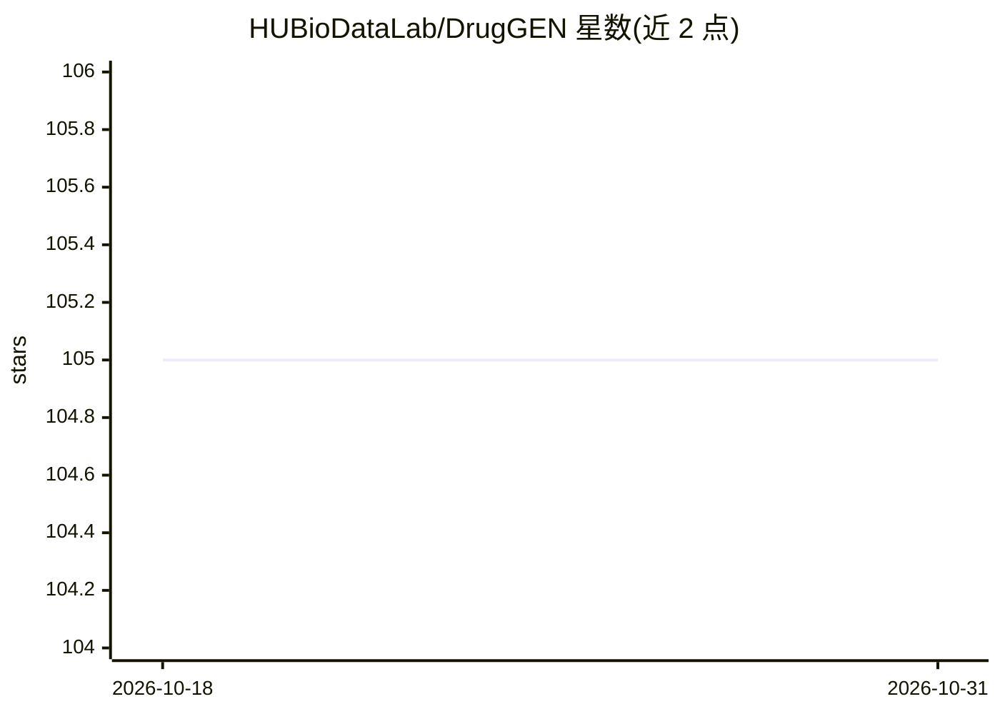

# HUBioDataLab/DrugGEN

⭐ 105 · Python · GPL-3.0 · 推送 2026-08-11 · [GitHub](https://github.com/HUBioDataLab/DrugGEN) · 组织维护

**面向特定靶蛋白的药物分子从头生成系统（图Transformer GAN）**

DrugGEN 是端到端生成式模型：将分子表示为图，用含图 Transformer 层的生成对抗网络，针对选定蛋白质从头设计候选药物分子。提供靶点特异版（DrugGEN）与非靶点特异版（NoTarget），训练数据为 ChEMBL 化合物与 AKT1/CDK2 靶点生物活性分子。提供 train.py 训练与 inference.py 生成脚本，setup.sh 从 Google Drive 下载模型权重与数据，conda 环境安装；支持 CPU-only 运行，GPU 用于加速训练推断。研究人员可基于已知活性分子数据集为其他靶点重训模型。

## 筛选速览

| 维度 | 判定 | 备注 |
|---|---|---|
| AI 角色 | `ai-native` | 本体是模型或模型工具 |
| 许可风险 | `viral` | GPL-3.0 |
| 部署形态 | `None` |  |
| 模型依赖 | — | README 未给出锁定关系 |
| 硬件要求 | `cpu-ok` | |
| 安装摩擦 | `medium` | 含编译或系统依赖之一 |
| 成熟度 | — | 结构信号不足 |

## 能力要点

- 图 Transformer 生成对抗网络生成靶点特异候选分子
- 内置 AKT1 与 CDK2 两个靶点训练配置，可重训至其他靶蛋白
- 提供 setup.sh 一键下载模型权重与数据资源
- 支持 CPU-only 运行，推断生成新分子

## 适用场景

- 为 AKT1/CDK2 等靶蛋白从头生成候选抑制剂分子
- 基于自有生物活性数据集重训模型用于其他靶点
- 非靶点特异地从 ChEMBL 化学空间采样分子

## 场景标签

 · 领域:药物发现/生成式AI

## 证据(README 行号)

> L11: Discovering novel drug candidate molecules is a fundamental step in drug development. Generative deep learning mode
> L75: - `train.py` - Main script for training the DrugGEN model

## 星数曲线

2026-10-18 105 → 2026-10-31 105（+0）

---
*卡片 v1 · prompt 1.4 · 生成 2026-10-23 · 置信度 high · 依据 README sha `5353996332be` · [字段定义](../../DATASET.md)*
