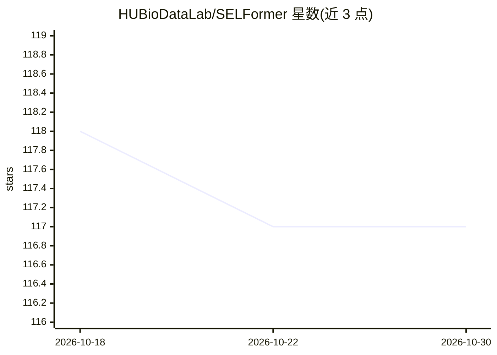

# HUBioDataLab/SELFormer

⭐ 117 · Python · 推送 2026-05-06 · [GitHub](https://github.com/HUBioDataLab/SELFormer) · 组织维护

**基于 SELFIES 的化学语言模型，用于分子表示学习与性质预测**

SELFormer 是基于 RoBERTa 架构的化学语言模型，以 SELFIES 分子字符串表示作为输入，在两百万药物类化合物上以掩码语言建模目标完成自监督预训练，并可微调用于分子性质预测的二分类、多标签分类与回归任务。提供预训练模型下载、CHEMBL30/33 与 MoleculeNet 分子嵌入生成脚本，以及预训练与微调的命令行工具。推荐通过 Conda 环境安装依赖，面向化学信息学与药物发现方向的研究者和开发者。

## 筛选速览

| 维度 | 判定 | 备注 |
|---|---|---|
| AI 角色 | `ai-native` | 本体是模型或模型工具 |
| 许可风险 | `none` | — |
| 部署形态 | `None` |  |
| 模型依赖 | — | README 未给出锁定关系 |
| 硬件要求 | — | 无带数字的原话,不猜 |
| 安装摩擦 | `low` | 无编译、无系统依赖或容器化 |
| 成熟度 | — | 结构信号不足 |

## 能力要点

- 以 SELFIES 表示输入的 RoBERTa 架构化学语言模型
- 在 200 万药物类化合物上自监督预训练
- 支持二分类/多标签分类/回归三类分子性质预测微调
- 提供预训练模型与 CHEMBL30/33、MoleculeNet 嵌入下载及生成脚本

## 适用场景

- 为自己的分子数据集生成 SELFIES 表示与嵌入向量
- 在 BBBP、Tox21、ESOL 等数据集上微调做分子性质预测
- 从头预训练或复现化学语言模型实验

## 场景标签

`微调` `模型训练` · 领域:训练与推理

## 证据(README 行号)

> L5: Automated computational analysis of the vast chemical space is critical for numerous fields of research such as drug
> L13: SELFormer is built on the RoBERTa transformer architecture, which utilizes the same architecture as BERT, but with 

## 星数曲线

2026-10-18 118 → 2026-10-30 117（-1）

---
*卡片 v1 · prompt 1.4 · 生成 2026-10-23 · 置信度 high · 依据 README sha `d1f908a980c0` · [字段定义](../../DATASET.md)*
