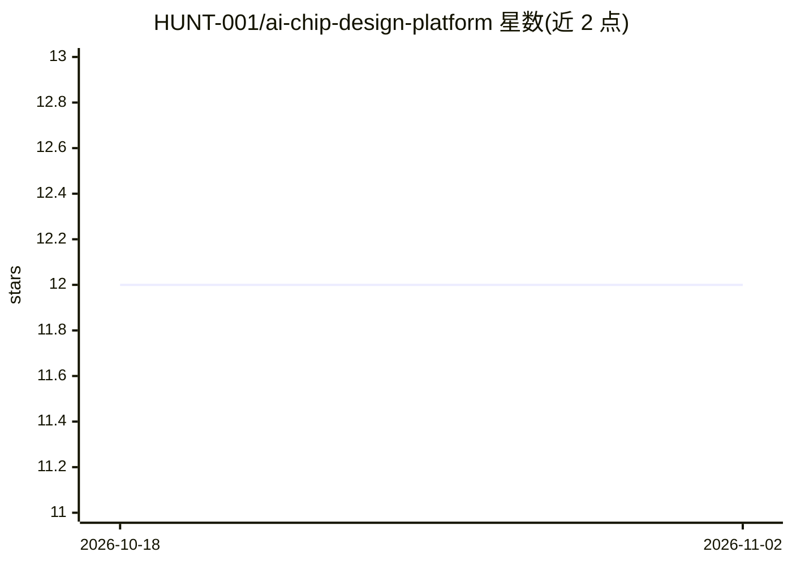

# HUNT-001/ai-chip-design-platform

⭐ 12 · Python · Apache-2.0 · 推送 2026-11-01 · [GitHub](https://github.com/HUNT-001/ai-chip-design-platform) · 组织维护

**RISC-V RTL 多智能体验证平台，附验证结论可信度研究轨道**

AVA 读取 RTL 后运行语义分析、生成 testbench、将设计与 Spike ISS 黄金模型逐指令比对提交日志、分析覆盖率并针对未覆盖路径生成新测试，由 12 个流水线代理加 14 个扩展模块组成，核心循环为纯 Python、无需 EDA 工具；Verilator/Spike/Yosys/RISC-V GCC 等为可选解锁项，缺失时代理如实报告未运行。LLM 层可经 --no-llm 关闭。VOE 研究轨道要求每个结论附带可复核的 witness 产物，策略变更先预注册并记入仅追加台账。面向芯片验证与形式化方法研究者。

## 筛选速览

| 维度 | 判定 | 备注 |
|---|---|---|
| AI 角色 | `ai-enhanced` | 去掉 AI 部分产品仍成立 |
| 许可风险 | `permissive` | Apache-2.0 |
| 部署形态 | `library` | 以包/库形式分发 |
| 模型依赖 | — | README 未给出锁定关系 |
| 硬件要求 | — | 无带数字的原话,不猜 |
| 安装摩擦 | `medium` | 含编译或系统依赖之一 |
| 成熟度 | — | 结构信号不足 |

## 能力要点

- 12 个流水线代理 + 14 个扩展模块，核心循环纯 Python 无需 EDA 工具链
- RTL 与 Spike ISS 黄金模型的逐指令提交日志比对
- VOE 证据内核：无 witness 的结论不可存在，witness 被重新哈希核验
- 验证置信度分档（VERIFIED/HIGH/MEDIUM/LOW/CRITICAL），未运行的代理不贡献默认值

## 适用场景

- 给 RISC-V 核跑自动化验证流水线并得到置信度分档结论
- 针对覆盖率缺口自动生成新测试激励
- 研究自动化验证结论本身的可信度并复核证据产物

## 场景标签

`多智能体` · 领域:Agent 开发

## 证据(README 行号)

> L20: **AVA** is a verification pipeline. Give it RTL and it runs semantic analysis,
> L225: |`--no-llm`|Disable the LLM layer|

## 星数曲线

2026-10-18 12 → 2026-11-02 12（+0）

---
*卡片 v1 · prompt 1.4 · 生成 2026-11-01 · 置信度 mid · 依据 README sha `4af66e65eb9f` · [字段定义](../../DATASET.md)*
