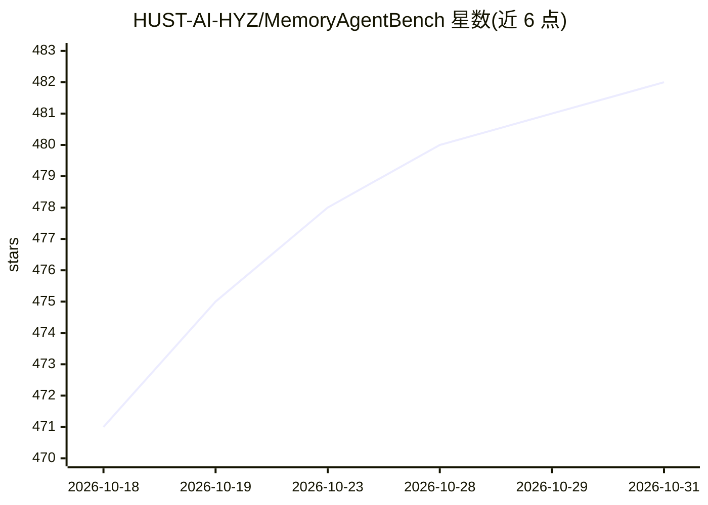

# HUST-AI-HYZ/MemoryAgentBench

⭐ 482 · Python · MIT · 推送 2026-09-25 · [GitHub](https://github.com/HUST-AI-HYZ/MemoryAgentBench) · [官网](https://arxiv.org/abs/2507.05257) · 组织维护

**评测带记忆 LLM agent 的基准：增量多轮交互四能力测试**

ICLR 2026 论文配套开源基准，通过将长文本切分为 chunk 模拟多轮增量交互，评测 agent 记忆能力的四项维度：精确检索（AR）、测试时学习（TTL）、长程理解（LRU）、冲突消解（CR）。数据来自既有基准的重组，并新构建 EventQA 与 FactConsolidation 两个数据集，采用“注入一次、多次查询”设计提高评测效率。面向科研人员，通过 conda/pip 安装、HuggingFace 下载数据、配置 API key 后用 bash 脚本运行评测，指标覆盖 substring/exact match、Recall@5 与 LLM-as-judge。限制：hipporag 依赖 openai==1.58.1，与最新 OpenAI 模型存在环境冲突。

## 筛选速览

| 维度 | 判定 | 备注 |
|---|---|---|
| AI 角色 | `ai-ecosystem` | LLM/agent 周边工具 |
| 许可风险 | `permissive` | MIT |
| 部署形态 | `library` | 以包/库形式分发 |
| 模型依赖 | — | README 未给出锁定关系 |
| 硬件要求 | — | 无带数字的原话,不猜 |
| 安装摩擦 | `low` | 无编译、无系统依赖或容器化 |
| 成熟度 | — | 结构信号不足 |

## 能力要点

- 四项记忆能力维度评测（AR/TTL/LRU/CR）
- “注入一次、多次查询”的评测效率设计
- 新构建 EventQA 与 FactConsolidation 数据集
- 支持长上下文 agent、RAG agent 与 agentic memory 方法的评测脚本

## 适用场景

- 评测我的记忆增强 agent 在多轮长交互下的表现
- 复现论文中的基准实验与消融研究
- 比较不同 RAG/记忆方法的检索与冲突消解能力

## 场景标签

`模型评测` `科研工具` · 领域:评测与运维

## 证据(README 行号)

> L1: # ⚙️ MemoryAgentBench: Evaluating Memory in LLM Agents via Incremental Multi-Turn Interactions
> L5: This project benchmarks agents with memory capabilities. Follow the steps below to set up your environment and insta
> L11: Four Core Competencies for Evaluation:

## 星数曲线

2026-10-18 471 → 2026-10-31 482（+11）

---
*卡片 v1 · prompt 1.4 · 生成 2026-10-23 · 置信度 high · 依据 README sha `43cbaaa66445` · [字段定义](../../DATASET.md)*
