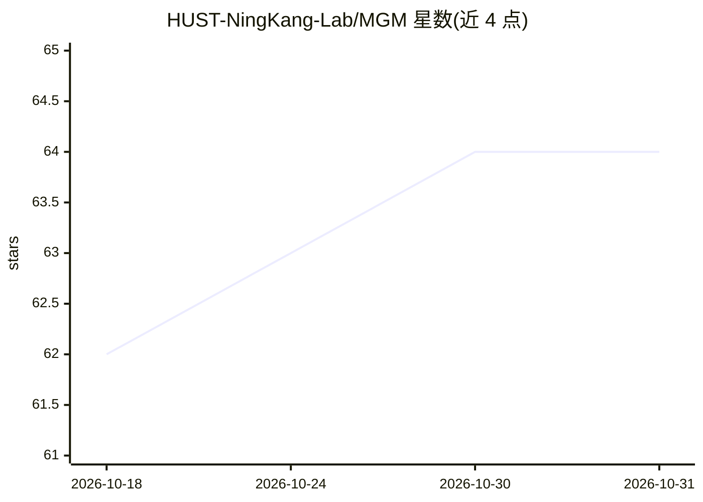

# HUST-NingKang-Lab/MGM

⭐ 64 · Jupyter Notebook · MIT · 推送 2026-01-26 · [GitHub](https://github.com/HUST-NingKang-Lab/MGM) · 组织维护 · 中文 README

**面向微生物组数据分析的大规模预训练语言模型**

MGM 是用于可解释微生物组数据分析的大规模预训练语言模型，以 Python 包（microformer-mgm）与 mgm CLI 提供。功能覆盖数据准备（将 hdf5/csv/tsv 丰度数据转为系统发育归一化的微生物组语料）、预训练、监督训练、微调、预测、合成微生物组数据生成与丰度重建。随附 MicroCorpus-260K 数据集（263,302 个来自 MGnify 的样本）与可解释性示例 Notebook（提取嵌入、注意力权重识别关键菌属）。由华中科技大学团队维护，论文发表于 Advanced Science。

## 筛选速览

| 维度 | 判定 | 备注 |
|---|---|---|
| AI 角色 | `ai-native` | 本体是模型或模型工具 |
| 许可风险 | `permissive` | MIT |
| 部署形态 | `library` | 以包/库形式分发 |
| 模型依赖 | — | README 未给出锁定关系 |
| 硬件要求 | — | 无带数字的原话,不猜 |
| 安装摩擦 | `low` | 无编译、无系统依赖或容器化 |
| 成熟度 | — | 结构信号不足 |

## 能力要点

- 预训练/微调/预测/生成/重建的完整 CLI 流程
- MicroCorpus-260K 数据集：263,302 个微生物组样本
- 通过注意力权重识别关键微生物属的可解释性分析
- 支持合成微生物组数据生成与标签解码

## 适用场景

- 在我的微生物组数据上微调 MGM 做分类预测
- 利用注意力权重找出影响结果的关键菌属
- 生成合成微生物组样本补充训练数据

## 场景标签

`微调` `模型训练` · 领域:训练与推理

## 证据(README 行号)

> L8: **Microbial General Model (MGM)** is a large-scale pretrained language model designed for interpretable microbiome d
> L30: ## MicroCorpus-260K

## 星数曲线

2026-10-18 62 → 2026-10-31 64（+2）

---
*卡片 v1 · prompt 1.4 · 生成 2026-10-24 · 置信度 high · 依据 README sha `fa82d3c06c8d` · [字段定义](../../DATASET.md)*
