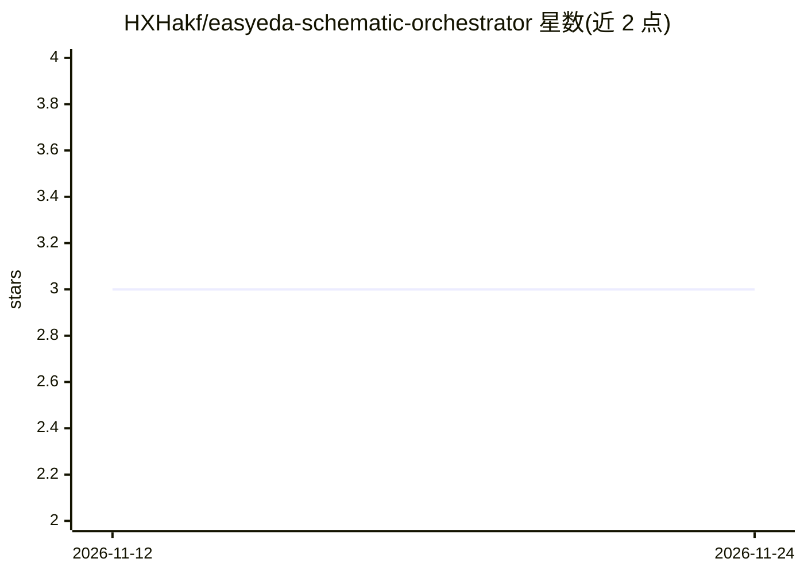

# HXHakf/easyeda-schematic-orchestrator

⭐ 3 · Python · MIT · 推送 2026-11-20 · [GitHub](https://github.com/HXHakf/easyeda-schematic-orchestrator) · 个人维护 · 中文 README

**为嘉立创EDA专业版提供AI原理图绘制工作流Skill**

以 Skill 形式部署于宿主 AI（如 Codex）的工作流编排器：宿主 AI 负责理解需求、检索官方手册与设计审阅，Python 端执行确定性校验，配套上游 easyeda-agent 提供 CLI、daemon 与 EDA Agent Connector 完成绘图。流程覆盖需求选型、设计契约确认、放置布线、写入回读与证据交付，内置 25 类元件知识卡与 6 个应用主题，经 304 项主测试与离线烟雾测试验证。当前执行适配嘉立创 EDA 专业版，写入范围限定专用空白页。

## 筛选速览

| 维度 | 判定 | 备注 |
|---|---|---|
| AI 角色 | `ai-native` | 本体是模型或模型工具 |
| 许可风险 | `permissive` | MIT |
| 部署形态 | `desktop` | 安装包/桌面程序 |
| 模型依赖 | — | README 未给出锁定关系 |
| 硬件要求 | — | 无带数字的原话,不猜 |
| 安装摩擦 | `low` | 无编译、无系统依赖或容器化 |
| 成熟度 | — | 结构信号不足 |

## 能力要点

- 宿主 AI + Python 确定性校验的双层架构，写入前生成中文 Design Contract 供用户确认
- 25 类元件知识卡、6 个应用主题、58 个唯一来源的本地知识库，支持 kb-search 离线检索
- execute --verify 写入后保存重开并逐脚回读，deliver 阶段以六项图面审阅阻断不合规交付
- 304 项主测试、76 项附加审计与 3 套离线演示，CI 覆盖三大操作系统

## 适用场景

- 让宿主 AI 依据官方手册在嘉立创 EDA 中绘制原理图
- 绘图前通过中文设计确认与参数核验把关方案
- 中断后恢复现场，补放缺件并回读验证

## 场景标签

`工作流自动化` · 领域:效率与自动化

## 证据(README 行号)

> L3: **面向嘉立创 EDA 专业版的 AI 原理图绘制工作流**
> L9: 宿主 AI 负责理解需求、查阅资料和设计审阅，Python 执行确定性校验，
> L10: easyeda-agent 提供 CLI、daemon 与 EDA Agent Connector 绘图能力。

## 星数曲线

2026-11-12 3 → 2026-11-24 3（+0）

---
*卡片 v1 · prompt 1.4 · 生成 2026-11-22 · 置信度 high · 依据 README sha `73e7b8f03217` · [字段定义](../../DATASET.md)*
