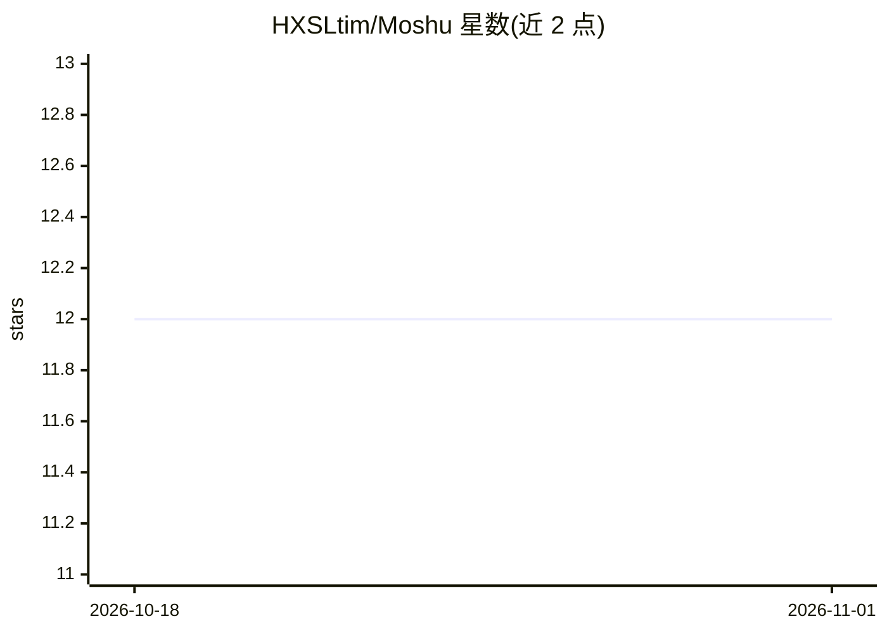

# HXSLtim/Moshu

⭐ 12 · Python · 推送 2026-10-12 · [GitHub](https://github.com/HXSLtim/Moshu) · [官网](https://github.com/HXSLtim/Nai) · 个人维护 · 中文 README

**作者主导的本地 AI 长篇小说创作系统，多Agent协作续写**

面向小说作者的本地自部署创作平台：提供 VS Code 式创作工作区、章节与版本管理、Story Bible 事实与事件账本、RAG 上下文检索、AI 续写/改写/编排与一致性检查、六维章节审核。核心机制为作者数据是唯一真源，所有 AI 产出均为候选提案，由作者按审核模式裁决后写入；创作对话 Agent 通过受权工具查阅设定与前文并触发生成动作。技术栈为 FastAPI+LangGraph+Chroma 后端与 Next.js 前端，通过 OpenAI 兼容接口接 LM Studio 或 DeepSeek。当前为本地 Alpha 阶段，角色管理界面、EPUB 导出等尚未完成。

## 筛选速览

| 维度 | 判定 | 备注 |
|---|---|---|
| AI 角色 | `ai-native` | 本体是模型或模型工具 |
| 许可风险 | `none` | — |
| 部署形态 | `self-host` | docker 或自建部署 |
| 模型依赖 | — | README 未给出锁定关系 |
| 硬件要求 | — | 无带数字的原话,不猜 |
| 安装摩擦 | `low` | 无编译、无系统依赖或容器化 |
| 成熟度 | `idea` | |

## 能力要点

- AI 产出均为候选提案，作者三档审核后写入
- Story Bible 事实/事件账本 + 按章节范围过滤的 Chroma RAG
- LangGraph 三阶段生成工作流与六维章节审核
- 四层记忆（原文/简介/大纲/人物状态）接入生成上下文

## 适用场景

- 长篇小说写作中让 AI 续写、改写并保持设定一致性
- 管理世界观、人物事实与剧情事件的账本
- 本地部署并连接自选模型进行创作

## 场景标签

`多智能体` `RAG` `AI 写作` · 领域:Agent 开发

## 证据(README 行号)

> L3: 墨枢 是一个作者主导的本地小说创作工具，提供章节管理、版本化保存、Story Bible 事实与事件账本、AI 续写、RAG 上下文检索、一致性检查和多维审核。
> L15: - 创作对话 Agent 可主动查阅设定账本、角色卡、前章简介、全书大纲与前文正文，交稿前可用一致性检查自查草稿；还可经能力工具发起高级续写、编排、选区改写与剧情方向等生成动作，产出一律为候选提案，按本书审核模式处置；检索按作者归
> L47: - OpenAI 兼容模型接口（LM Studio 本地模型或 DeepSeek 远程模型）

## 星数曲线

2026-10-18 12 → 2026-11-01 12（+0）

---
*卡片 v1 · prompt 1.4 · 生成 2026-11-01 · 置信度 mid · 依据 README sha `174bdedccd15` · [字段定义](../../DATASET.md)*
