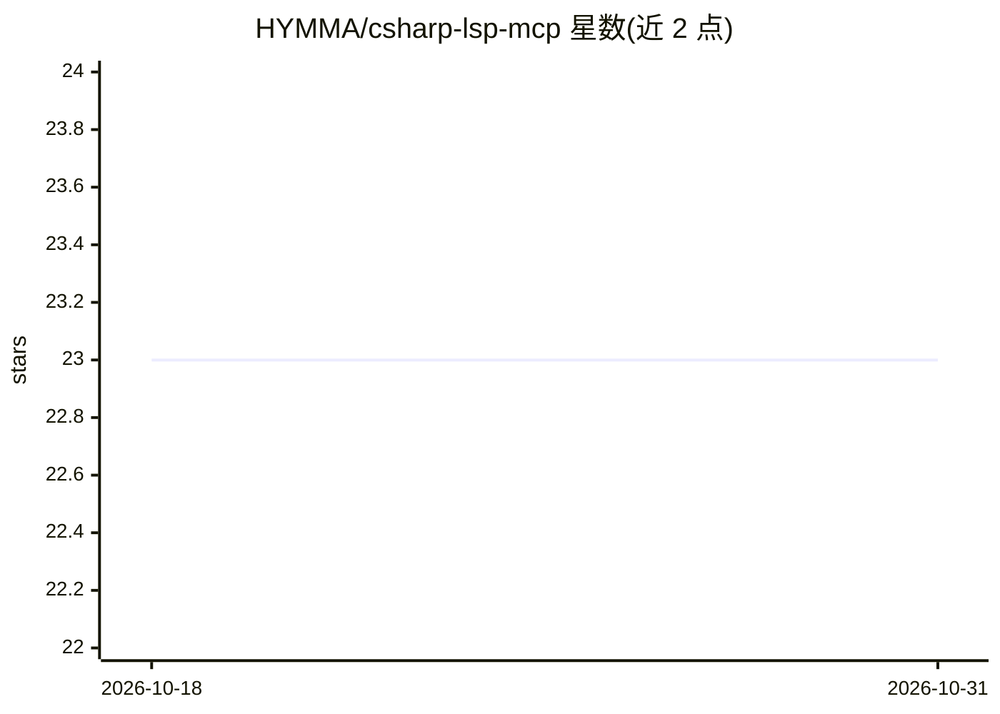

# HYMMA/csharp-lsp-mcp

⭐ 23 · C# · MIT · 推送 2026-03-02 · [GitHub](https://github.com/HYMMA/csharp-lsp-mcp) · 个人维护

**为 Claude 等 AI 助手提供 C#/XAML 语言智能的 MCP 服务器**

基于 MCP 协议的服务器，将 C# 与 XAML 的语言能力暴露给 Claude 等 AI 助手：C# 侧通过封装 csharp-ls 语言服务器提供诊断、悬停信息、IntelliSense 补全、跳转定义、查找引用、代码操作与重命名预览等 11 个工具；XAML 侧内置验证、绑定分析、资源检查、结构可视化与 ViewModel 生成等 7 个工具。面向 .NET 开发者，用于让 AI 助手在编程时获取编译器级信息。前置要求 .NET 8.0 SDK，csharp-ls 需以 dotnet tool 单独安装，NuGet 安装方式标注 coming soon，当前从源码构建。LSP 会持有 DLL 文件锁，重构建前需调用 csharp_stop。

## 筛选速览

| 维度 | 判定 | 备注 |
|---|---|---|
| AI 角色 | `ai-ecosystem` | LLM/agent 周边工具 |
| 许可风险 | `permissive` | MIT |
| 部署形态 | `None` |  |
| 模型依赖 | — | README 未给出锁定关系 |
| 硬件要求 | — | 无带数字的原话,不猜 |
| 安装摩擦 | `medium` | 含编译或系统依赖之一 |
| 成熟度 | — | 结构信号不足 |

## 能力要点

- 封装 csharp-ls 暴露 11 个 C# 语言工具（诊断/补全/定义/引用等）
- 内置 XAML 分析：验证、绑定分析、ViewModel 生成等 7 个工具
- 支持 Claude Code 与 Claude Desktop 的 MCP 配置接入
- csharp_stop/csharp_set_workspace 管理 LSP 生命周期与文件锁

## 适用场景

- 让 Claude Code/Desktop 在 .NET 项目中获得实时编译诊断
- 让 AI 助手查找符号定义与引用、执行重命名预览
- 分析 XAML 数据绑定并从绑定生成 ViewModel

## 场景标签

 · 领域:开发工具/AI 编程辅助

## 证据(README 行号)

> L11: An MCP (Model Context Protocol) server that provides C# and XAML language intelligence for AI assistants like Claud
> L96: Once configured, the MCP server provides the following tools to your AI assistant:

## 星数曲线

2026-10-18 23 → 2026-10-31 23（+0）

---
*卡片 v1 · prompt 1.4 · 生成 2026-10-27 · 置信度 high · 依据 README sha `0500aeb9da78` · [字段定义](../../DATASET.md)*
