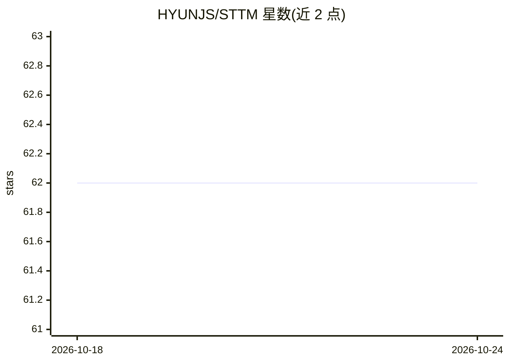

# HYUNJS/STTM

⭐ 62 · Python · 推送 2026-02-02 · [GitHub](https://github.com/HYUNJS/STTM) · [官网](https://www.jshyun.me/projects/sttm) · 组织维护

**免训练的视频 LLM 时空 token 合并加速方法（ICCV 2025 论文代码）**

ICCV 2025 论文的官方代码库，提出 STTM：免训练的时空 token 合并方法，支持 KV-cache 复用，分两步执行——基于四叉树的空间合并与多粒度空间 token 的时间合并。在 LLaVA-Video-7B/72B、LLaVA-OneVision-7B 与 Qwen2VL-7B 三个模型上验证，覆盖 VNBench、Video-MME、LongVideoBench、MLVU、NExT-QA、EgoSchema 六个视频问答基准。仓库提供环境搭建、数据集组织说明、HuggingFace 预处理特征下载、特征提取与评测脚本，支持 --reproduce 固定随机种子复现。

## 筛选速览

| 维度 | 判定 | 备注 |
|---|---|---|
| AI 角色 | `ai-ecosystem` | LLM/agent 周边工具 |
| 许可风险 | `none` | — |
| 部署形态 | `None` |  |
| 模型依赖 | — | README 未给出锁定关系 |
| 硬件要求 | — | 无带数字的原话,不猜 |
| 安装摩擦 | `medium` | 含编译或系统依赖之一 |
| 成熟度 | — | 结构信号不足 |

## 能力要点

- 免训练的时空 token 合并，支持 KV-cache 复用
- 四叉树空间合并 + 多粒度时间合并两步机制
- 在 LLaVA-Video、LLaVA-OneVision、Qwen2VL 三个模型上验证
- 提供 Video-MME 与 VNBench 的预处理特征下载（HuggingFace）

## 适用场景

- 复现论文在六个视频问答基准上的评测结果
- 为 LLaVA/Qwen2VL 类视频模型接入 token 合并以减少计算量
- 研究视频 LLM 的免训练加速与 KV-cache 复用

## 场景标签

`推理引擎` · 领域:训练与推理

## 证据(README 行号)

> L7: STTM is a training-free spatio-temporal token merging method that supports KV-cache reuse.
> L10: STTM is validated using three models: LLaVA-Video-7B/72B, LLaVA-OneVision-7B, and Qwen2VL-7B. Evaluation is conduct

## 星数曲线

2026-10-18 62 → 2026-10-24 62（+0）

---
*卡片 v1 · prompt 1.4 · 生成 2026-10-24 · 置信度 high · 依据 README sha `95cc5c7d344d` · [字段定义](../../DATASET.md)*
