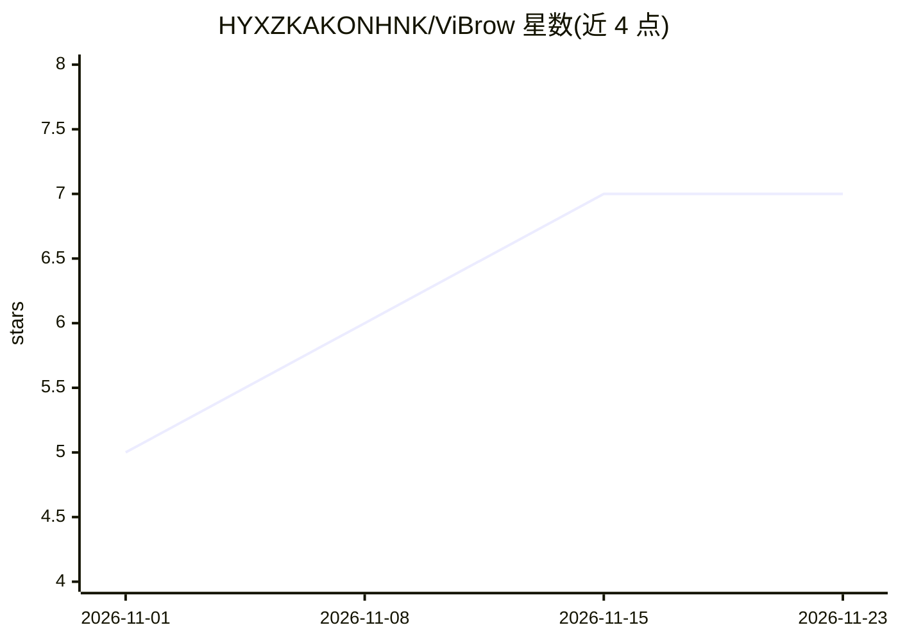

# HYXZKAKONHNK/ViBrow

⭐ 7 · Python · AGPL-3.0 · 推送 2026-11-21 · [GitHub](https://github.com/HYXZKAKONHNK/ViBrow) · 个人维护

**纯 Python+Zig 自研引擎的低资源设备浏览器**

用 Python 标准库（Tkinter/socket/ssl/threading）与部分 Zig 代码编写的网页浏览器，自带 DOM 解析、CSS 渲染和名为 viengine 的 JavaScript 虚拟机（VMIT 架构，采用 NaN Boxing）。面向树莓派、Orange Pi 等低配微型计算机，宣称在单核 700MHz CPU、200MB 内存上运行，内存占用 30-65MB。功能含多标签、本地缓存、cookies、内置代理桥接，以及防 OOM 的后台守护进程（内存占用超 90% 时创建 512MB 交换文件）。另含 ViForge 打包器，可将 HTML 打包为独立应用或作为 IDE 运行。

## 筛选速览

| 维度 | 判定 | 备注 |
|---|---|---|
| AI 角色 | `ai-enhanced` | 去掉 AI 部分产品仍成立 |
| 许可风险 | `viral` | AGPL-3.0 |
| 部署形态 | `None` |  |
| 模型依赖 | — | README 未给出锁定关系 |
| 硬件要求 | — | 无带数字的原话,不猜 |
| 安装摩擦 | `low` | 无编译、无系统依赖或容器化 |
| 成熟度 | — | 结构信号不足 |

## 能力要点

- 自研 DOM/CSS 渲染与 VMIT JavaScript 引擎（含 NaN Boxing，部分以 Zig 编写）
- 无第三方依赖，仅使用 Python 标准库
- 内存占用 30-65MB，支持单核 700MHz CPU 与 200MB 内存设备
- 内置 OOM 防护：内存占用超 90% 时按操作系统创建应急交换空间

## 适用场景

- 在树莓派等低配微型计算机上运行网页浏览器
- 内存受限的旧硬件设备上网
- 将 HTML 文件打包为独立应用（ViForge）

## 场景标签

 · 领域:网络工具/桌面应用

## 证据(README 行号)

> L28: A lightweight, custom web browser written in pure Python and Zig, engineered specifically for low-resource microcom
> L32: * **Custom Layout Engines:** Built from scratch DOM parsing and CSS rendering.

## 星数曲线

2026-11-01 5 → 2026-11-23 7（+2）

---
*卡片 v1 · prompt 1.4 · 生成 2026-11-20 · 置信度 low · 依据 README sha `b8b12ed5fdf7` · [字段定义](../../DATASET.md)*
