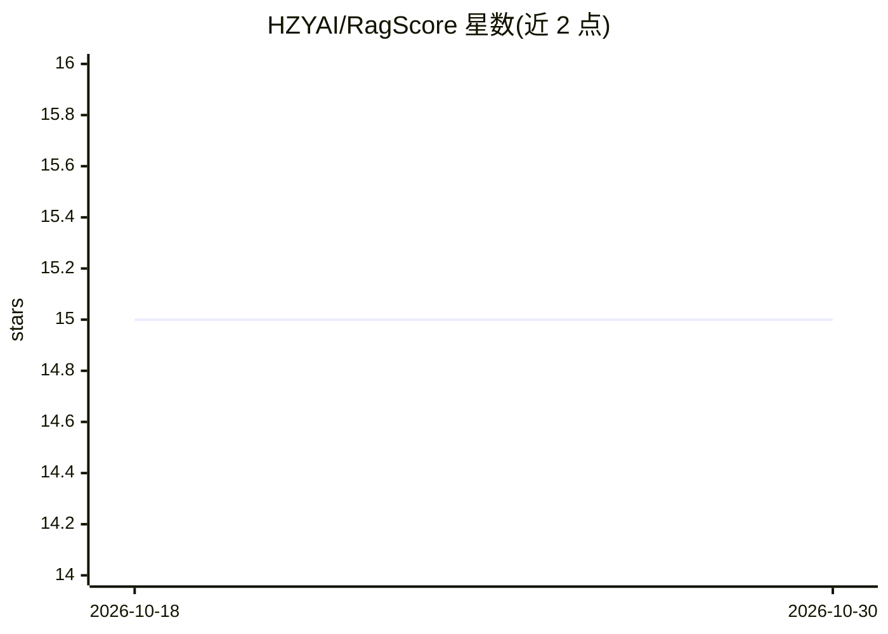

# HZYAI/RagScore

⭐ 15 · Python · Apache-2.0 · 推送 2026-05-29 · [GitHub](https://github.com/HZYAI/RagScore) · 个人维护 · 中文 README

**给 RAG 开发者：两条命令生成 QA 数据集并评测 RAG 系统**

面向 RAG 系统开发者的评测工具：从本地文档生成 QA 数据对（问题+答案+support span），指向任意 RAG 查询端点进行评测，输出准确率与错误 QA 清单。支持详细模式（正确性/完整性/相关性/简洁性/忠实度 5 维度）与失败根因分类（检索缺失/生成幻觉/答案不完整/理解错误）。提供 Python API、CLI、Colab/Jupyter 与 MCP server 模式。LLM 提供方覆盖 Ollama（本地无 key）、OpenAI、Anthropic、DashScope、vLLM 等；本地 Ollama 路径下数据不出本机。核心包 pip 安装，零配置即可运行。

## 筛选速览

| 维度 | 判定 | 备注 |
|---|---|---|
| AI 角色 | `ai-ecosystem` | LLM/agent 周边工具 |
| 许可风险 | `permissive` | Apache-2.0 |
| 部署形态 | `library` | 以包/库形式分发 |
| 模型依赖 | local-ok | 支持本地模型 |
| 硬件要求 | — | 无带数字的原话,不猜 |
| 安装摩擦 | `low` | 无编译、无系统依赖或容器化 |
| 成熟度 | — | 结构信号不足 |

## 能力要点

- 两条命令完成 QA 生成与 RAG 端点评测
- 5 维度详细评测与 4 类失败根因分类（--detailed / --diagnose）
- Ollama 本地模型支持，无 API key、数据不出本机
- Python API / CLI / Colab / MCP server 多种使用方式

## 适用场景

- 为我的 RAG 系统快速生成评测用 QA 数据集
- 上线前评测 RAG 回答质量并定位失败根因
- 医疗/法律/金融等敏感文档场景用本地模型做私有化评测

## 场景标签

`模型评测` `RAG` · 领域:评测与运维

## 证据(README 行号)

> L11:  **Generate QA datasets & evaluate RAG systems in 2 commands**
> L24: ragscore evaluate http://localhost:8000/query
> L204: ## 🔌 Supported LLMs

## 星数曲线

2026-10-18 15 → 2026-10-30 15（+0）

---
*卡片 v1 · prompt 1.4 · 生成 2026-10-30 · 置信度 high · 依据 README sha `c3150679f303` · [字段定义](../../DATASET.md)*
