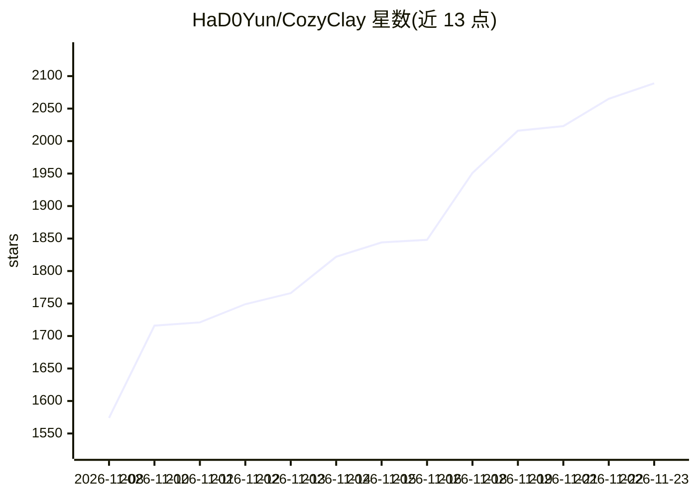

# HaD0Yun/CozyClay

⭐ 2,089 · JavaScript · AGPL-3.0 · 推送 2026-11-22 · [GitHub](https://github.com/HaD0Yun/CozyClay) · [官网](https://cozyclay.org) · 个人维护

**给影视/动画创作者：浏览器内3D预演并导出到AI视频模型**

浏览器中的开源 previs（预演）工具：用基础几何搭建场景、放置绑定角色、编排镜头运动与剪辑，随后将首末帧、灰盒参考片段、相机参数与提示词打包导出给 AI 视频模型。动作描述由 agent 生成 motion spec，浏览器内确定性编译器逐帧烘焙，并有碰撞/滑步等 QA 检查。可通过 Agent 面板、MCP 服务器或终端三种方式驱动。需 Node.js 22.19+ 与 Chromium 浏览器，无需 GPU、Python 或模型下载，AGPL-3.0 许可。

## 筛选速览

| 维度 | 判定 | 备注 |
|---|---|---|
| AI 角色 | `ai-enhanced` | 去掉 AI 部分产品仍成立 |
| 许可风险 | `viral` | AGPL-3.0 |
| 部署形态 | `library` | 以包/库形式分发 |
| 模型依赖 | — | README 未给出锁定关系 |
| 硬件要求 | — | 无带数字的原话,不猜 |
| 安装摩擦 | `low` | 无编译、无系统依赖或容器化 |
| 成熟度 | — | 结构信号不足 |

## 能力要点

- 导出关键帧包（首末帧、灰盒片段、相机、提示词）、mp4、深度/法线通道与 OTIO 剪辑清单
- 自然语言动作生成 motion spec，浏览器内确定性编译器烘焙每一帧，附碰撞/滑步/触及 QA 检查
- 三种 AI 驱动入口：工作室内 Agent 面板、MCP 服务器（Claude Desktop/Code/Cursor）、终端 JSON 协议
- npx 一条命令启动，不需要 GPU、Python 或模型下载

## 适用场景

- 在花钱调用视频模型前，先用 3D 灰盒确定走位、镜头与剪辑点
- 通过 MCP 让 Claude Desktop/Cursor 等客户端直接操作预演场景
- 制作分镜板（storyboard）与动态分镜（animatic）

## 场景标签

 · 领域:创作工具/影视预演与AI视频

## 证据(README 行号)

> L15:  Open source previs in a browser tab: block the set, move the cast, cut the camera, hand the shot to an AI video mo
> L42: model gets the shot as a first frame, a greybox reference clip and a prompt that describes the
> L76: |**Shoot**|Put shots on a timeline, draw dolly rails, look through the lens. Each shot knows the limits of the vide

## 星数曲线

2026-11-08 1,574 → 2026-11-23 2,089（+515）

---
*卡片 v1 · prompt 1.4 · 生成 2026-11-23 · 置信度 high · 依据 README sha `ccb68e0c420e` · [字段定义](../../DATASET.md)*
