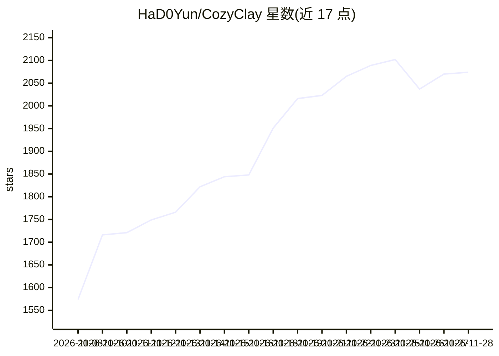

# HaD0Yun/CozyClay

⭐ 2,074 · JavaScript · AGPL-3.0 · 推送 2026-11-27 · [GitHub](https://github.com/HaD0Yun/CozyClay) · [官网](https://cozyclay.org) · 个人维护

**给影视预演创作者的浏览器 3D 分镜工具，衔接 AI 视频模型**

浏览器中运行的开源 previs 软件：用几何体搭建场景、摆放方块角色、绘制轨道摄影机与镜头切换，导出首末帧、灰盒参考片段、提示词与 OTIO 剪辑清单，供 AI 视频模型生成镜头。动作可通过 Agent 面板描述，由模型写出 motion spec 后由确定性引擎逐帧生成并做脚滑、接触、平衡等测量。需 Node.js 22.19+ 与 Chromium，无需 GPU、Python 或模型下载，npx 一条命令启动。

## 筛选速览

| 维度 | 判定 | 备注 |
|---|---|---|
| AI 角色 | `ai-enhanced` | 去掉 AI 部分产品仍成立 |
| 许可风险 | `viral` | AGPL-3.0 |
| 部署形态 | `library` | 以包/库形式分发 |
| 模型依赖 | — | README 未给出锁定关系 |
| 硬件要求 | — | 无带数字的原话,不猜 |
| 安装摩擦 | `low` | 无编译、无系统依赖或容器化 |
| 成熟度 | — | 结构信号不足 |

## 能力要点

- 3D 灰盒分镜 → 首末帧/参考片段/提示词导出到 AI 视频模型
- Agent 面板描述动作，motion writer 写 spec、确定性引擎逐帧生成并量化质检
- 支持 MCP server 与终端 JSON 协议，可由 Claude Desktop/Cursor 等 agent 驱动
- 导出深度与法线通道、接触表、OTIO 剪辑清单

## 适用场景

- 先用 3D 灰盒确定走位与镜头，再交给 AI 视频模型出片
- 为每个镜头生成参考片段以固定摄影机运动
- 用 agent 通过 MCP 自动搭建和驱动场景

## 场景标签

 · 领域:影视预演/3D 工具

## 证据(README 行号)

> L74: |**Stage**|Build the set from primitives and place point, spot and directional lights. Add rig characters, drawn as
> L75: |**Move**|Describe the action in the Agent panel. A second model, the motion writer, writes a motion spec, and a de

## 星数曲线

2026-11-08 1,574 → 2026-11-28 2,074（+500）

---
*卡片 v1 · prompt 1.4 · 生成 2026-11-27 · 置信度 high · 依据 README sha `fa54fdef8092` · [字段定义](../../DATASET.md)*
