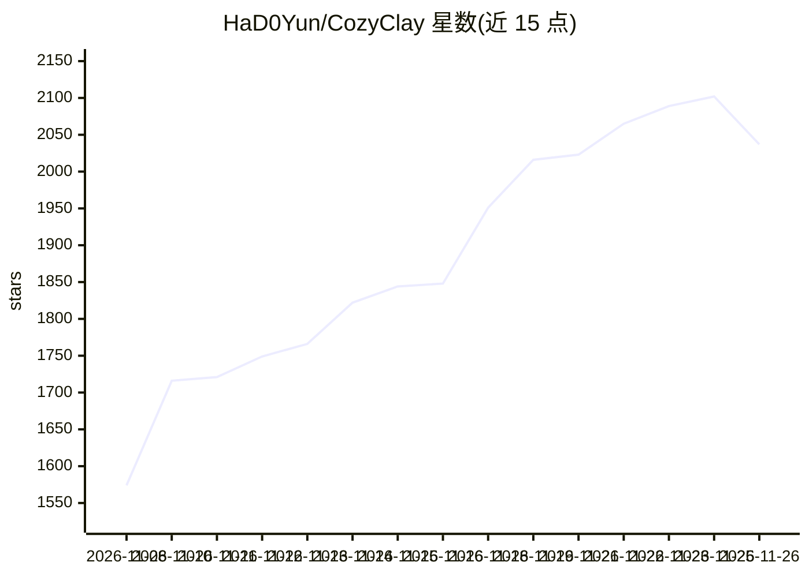

# HaD0Yun/CozyClay

⭐ 2,037 · JavaScript · AGPL-3.0 · 推送 2026-11-25 · [GitHub](https://github.com/HaD0Yun/CozyClay) · [官网](https://cozyclay.org) · 个人维护

**浏览器 3D 预演工具：先排戏再交给 AI 视频模型**

在浏览器中运行的预演（previs）软件：用积木式灰盒搭建场景、摆位角色、设计镜头运动与剪切，然后将首末帧、灰盒参考片段、相机与提示词打包导出给 AI 视频模型。动作可由 Agent 面板中的 motion writer 模型描述生成，由确定性引擎逐帧计算并度量脚滑、接触与平衡；支持 MCP 服务器与终端协议驱动运行中的工作室。安装为 npx 一条命令，需 Node 22.19+ 与 Chromium，无需 GPU 或模型下载。

## 筛选速览

| 维度 | 判定 | 备注 |
|---|---|---|
| AI 角色 | `ai-enhanced` | 去掉 AI 部分产品仍成立 |
| 许可风险 | `viral` | AGPL-3.0 |
| 部署形态 | `library` | 以包/库形式分发 |
| 模型依赖 | — | README 未给出锁定关系 |
| 硬件要求 | — | 无带数字的原话,不猜 |
| 安装摩擦 | `low` | 无编译、无系统依赖或容器化 |
| 成熟度 | — | 结构信号不足 |

## 能力要点

- 灰盒 blocking 导出为首帧、参考片段、相机与提示词的打包
- motion writer 模型写动作 spec，确定性引擎逐帧计算并度量脚滑/接触/平衡
- 三种 AI 驱动入口：Agent 面板聊天、MCP 服务器、终端 JSON 协议
- 导出 mp4、深度与法线 pass、OTIO 剪辑清单

## 适用场景

- 为 AI 视频生成提前确定走位、机位与剪切点，减少按次重试成本
- 在 3D 场景里用自然语言描述动作并生成动画
- 用 MCP 客户端或编码 agent 驱动场景搭建与拍摄

## 场景标签

`视频生成` · 领域:内容生成

## 证据(README 行号)

> L15:  Open source previs in a browser tab: block the set, move the cast, cut the camera, hand the shot to an AI video mo
> L75: |**Move**|Describe the action in the Agent panel. A second model, the motion writer, writes a motion spec, and a de
> L87: |**Agent panel**|`Cmd/Ctrl+B` in the studio|Chat in the studio. Sign in with ChatGPT or use your own key (Anthropic

## 星数曲线

2026-11-08 1,574 → 2026-11-26 2,037（+463）

---
*卡片 v1 · prompt 1.4 · 生成 2026-11-24 · 置信度 high · 依据 README sha `88667d207f63` · [字段定义](../../DATASET.md)*
