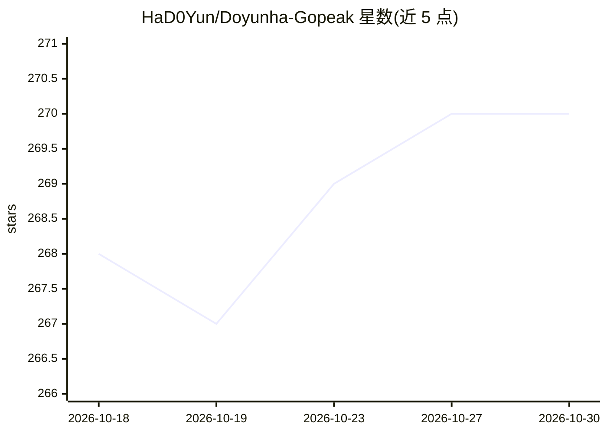

# HaD0Yun/Doyunha-Gopeak

⭐ 270 · TypeScript · MIT · 推送 2026-09-12 · [GitHub](https://github.com/HaD0Yun/Doyunha-Gopeak) · [官网](https://had0yun.github.io/Doyunha-Gopeak/) · 个人维护 · 中文 README

**面向 Godot 引擎的 MCP 服务器，供 AI 助手运行与调试项目**

GoPeak 是一个 MCP server，让 Claude Desktop、Cursor、Cline 等 MCP 客户端直接对 Godot 4 项目执行端到端操作：项目管理、场景/脚本/资源编辑、运行与调试输出采集、LSP 诊断与补全（端口 6005）、DAP 断点调试（端口 6006）、输入注入与截图、CC0 资产检索等，宣称 95+ 工具。默认 compact 配置只暴露可信核心工具，其余按动态工具组按需激活以控制 token 用量。要求 Godot 4.x 与 Node.js 18+；runtime/LSP/DAP 等能力需相应 addon 或端口前置条件。通过 npx 或 npm 全局安装运行，也可从源码构建。

## 筛选速览

| 维度 | 判定 | 备注 |
|---|---|---|
| AI 角色 | `ai-ecosystem` | LLM/agent 周边工具 |
| 许可风险 | `permissive` | MIT |
| 部署形态 | `library` | 以包/库形式分发 |
| 模型依赖 | — | README 未给出锁定关系 |
| 硬件要求 | — | 无带数字的原话,不猜 |
| 安装摩擦 | `low` | 无编译、无系统依赖或容器化 |
| 成熟度 | — | 结构信号不足 |

## 能力要点

- 95+ 工具覆盖项目管理、场景编辑、LSP/DAP 调试、输入注入与截图
- compact 配置 + 动态工具组按需激活，控制 token 用量
- tools/list 采用游标分页（默认每页 33 条）
- 提供 Editor Bridge / Runtime Addon 安装脚本（bash 与 PowerShell）

## 适用场景

- 让 AI 助手创建场景、编写脚本并运行项目修错
- 通过 DAP 断点与运行时检查做 Godot 调试
- 注入输入并截图做运行时自动化测试
- 用 visualizer.map 生成项目架构图

## 场景标签

`编码 Agent` · 领域:编码与开发

## 证据(README 行号)

> L11: **GoPeak is an MCP server for Godot that lets AI assistants run, inspect, modify, and debug real projects end-to-en
> L23: - MCP-compatible client (Claude Desktop, Cursor, Cline, OpenCode, etc.)

## 星数曲线

2026-10-18 268 → 2026-10-30 270（+2）

---
*卡片 v1 · prompt 1.4 · 生成 2026-10-22 · 置信度 high · 依据 README sha `9ce3b3d17cc1` · [字段定义](../../DATASET.md)*
